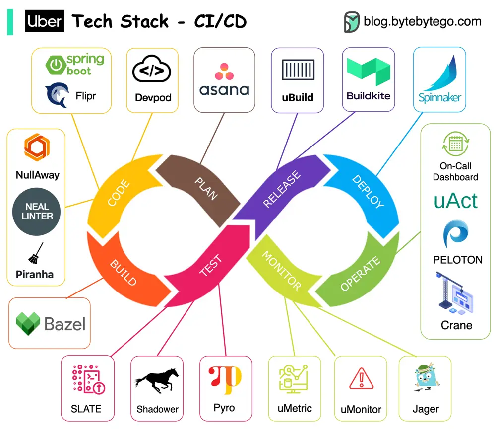

# ByteByteGo System Design 101: Uber Tech Stack - CI/CD

> Copied from <https://github.com/ByteByteGoHq/system-design-101> (CC BY-NC-ND 4.0, by ByteByteGo). Questions and answers are the source's own; nothing was answered or rewritten here.

Uber is one of the most innovative companies in the engineering field. Let’s take a look at their CI/CD tech stacks.

Note: This post is based on research on Uber engineering blogs. If you spot any inaccuracies, please let us know.

*   **Project planning:** JIRA

*   **Backend services:** Spring Boot to develop their backend services. And to make things even faster, they've created a nifty configuration system called Flipr that allows for speedy configuration releases.

*   **Code issues:** They developed NullAway to tackle NullPointer problems and NEAL to lint the code. Plus, they built Piranha to clean out-dated feature flags.

*   **Repository:** They believe in Monorepo. It uses Bazel on a large scale.

*   **Testing:** They use SLATE to manage short-lived testing environments and rely on Shadower for load testing by replaying production traffic. They even developed Ballast to ensure a smooth user experience.

*   **Experiment platform:** it is based on deep learning and they've generously open-sourced parts of it, like Pyro.

*   **Build:** Uber packages their services into containers using uBuild. It's their go-to tool, powered by Buildkite, for all the packaging tasks.

*   **Deploying applications:** Netflix Spinnaker. It's their trusted tool for getting things into production smoothly and efficiently.

*   **Monitoring:** Uber built their own monitoring systems. They use the uMetric platform, built on Cassandra, to keep things consistent.

*   **Special tooling:** Uber relies on Peloton for capacity planning, scheduling, and operations. Crane builds a multi-cloud infrastructure to optimize costs. And with uAct and the OnCall dashboard, they've got event tracing and on-call duty management covered.
