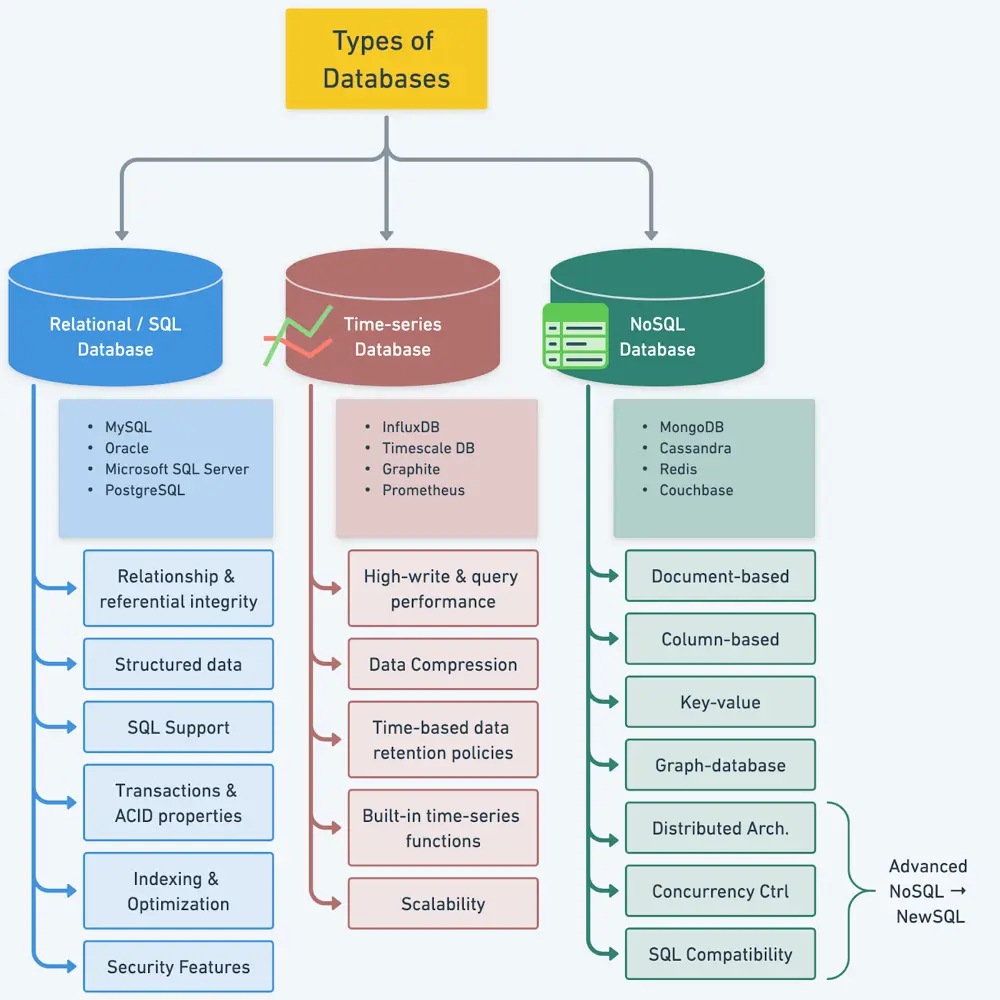

# ByteByteGo System Design 101: Understanding Database Types

> Copied from <https://github.com/ByteByteGoHq/system-design-101> (CC BY-NC-ND 4.0, by ByteByteGo). Questions and answers are the source's own; nothing was answered or rewritten here.

To make the best decision for our projects, it is essential to understand the various types of databases available in the market. We need to consider key characteristics of different database types, including popular options for each, and compare their use cases.
