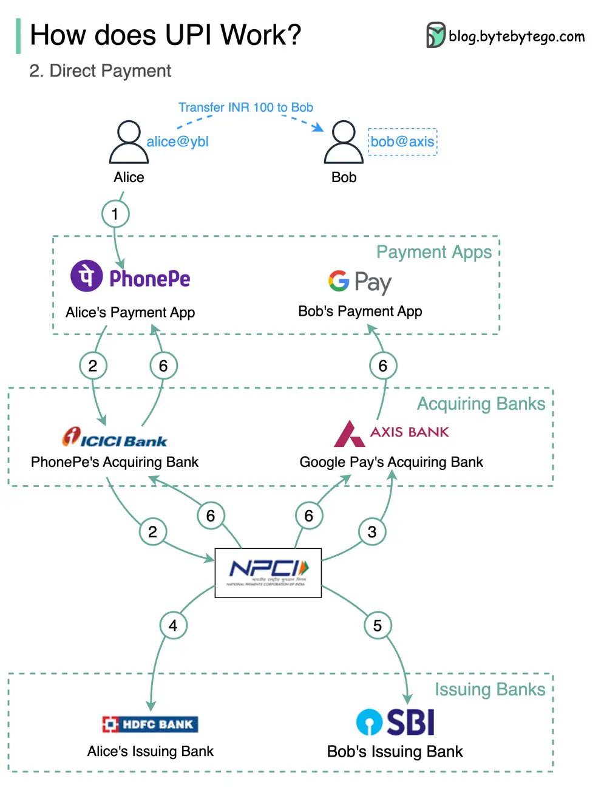

# ByteByteGo System Design 101: Unified Payments Interface (UPI)

> Copied from <https://github.com/ByteByteGoHq/system-design-101> (CC BY-NC-ND 4.0, by ByteByteGo). Questions and answers are the source's own; nothing was answered or rewritten here.

The Unified Payments Interface (UPI) for real-time transactions in India is a good case study for other nations in the payment space.

## What’s UPI?

UPI is an instant real-time payment system developed by the National Payments Corporation of India.

It accounts for 60% of digital retail transactions in India today and is still growing.

UPI = payment markup language + standard for interoperable payments

Let's take a look at how it works.

## Registration

*   Bob wants to open an account and provides his phone number +91 12345678

*   Bob performs OTP (One-Time Password) phone verification

*   Bob sets up VPA (Virtual Payment Address) bobaxis

*   Bob’s payment app creates VPA with the acquiring bank

*   The acquiring bank returns with VPA

*   The payment app returns VPA to Bob

## Link to Bank Account

*   Bob wants to link his SBI bank account with VPA bob at the axis. The request is forwarded to NPCI (National Payments Corporation of India).

*   NPCI acts as a switch between acquiring banks and issuing banks. It resolves the account detail from VPA with different issuing banks.

*   Bob authenticates with account details and sets the PIN, which is used for 2FA. This goes all the way to the issuing bank.

## Direct payment

1.  Alice enters Bob’s UPI ID bob and the amount INR 100

2.  PhonePe verifies and forwards the request to NPCI via ICICI bank

3.  NPCI requests Axis Bank to resolve detail for bob at axis

4.  NPCI deducts Alice’s HDFC bank account by INR 100

5.  NPCI sends an instruction to SBI bank and add INR 100 to Bob’s account in SBI bank.

6.  Upon success, NPCI notifies the payment apps via acquiring banks.
