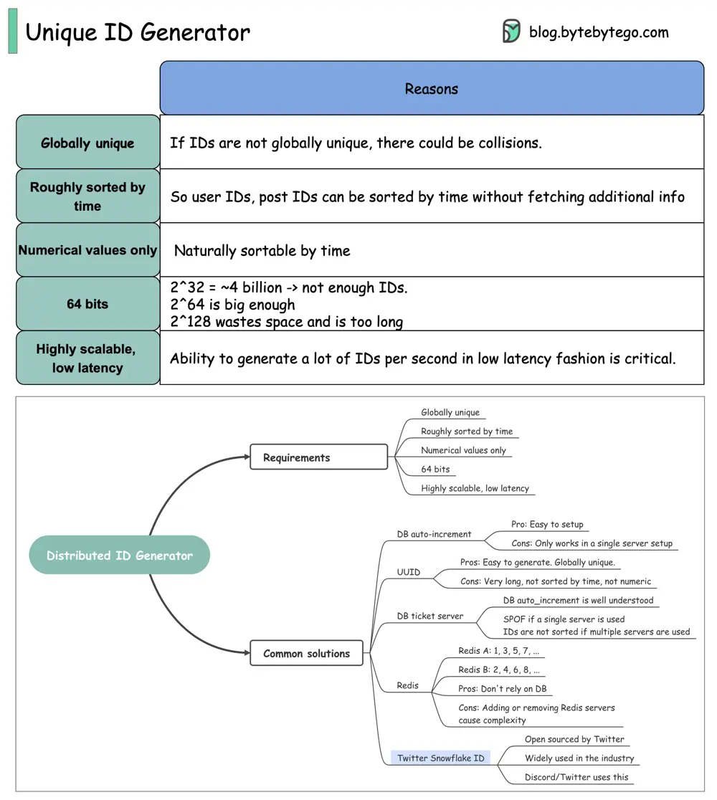

# ByteByteGo System Design 101: Unique ID Generator

> Copied from <https://github.com/ByteByteGoHq/system-design-101> (CC BY-NC-ND 4.0, by ByteByteGo). Questions and answers are the source's own; nothing was answered or rewritten here.

IDs are very important for the backend. Do you know how to generate globally unique IDs?

In this post, we explore common requirements for IDs that are used in social media such as Facebook, Twitter, and LinkedIn.

## Requirements:

*   Globally unique

*   Roughly sorted by time

*   Numerical values only

*   64 bits

*   Highly scalable, low latency

The implementation details of the algorithms can be found online so we will not go into detail here.
