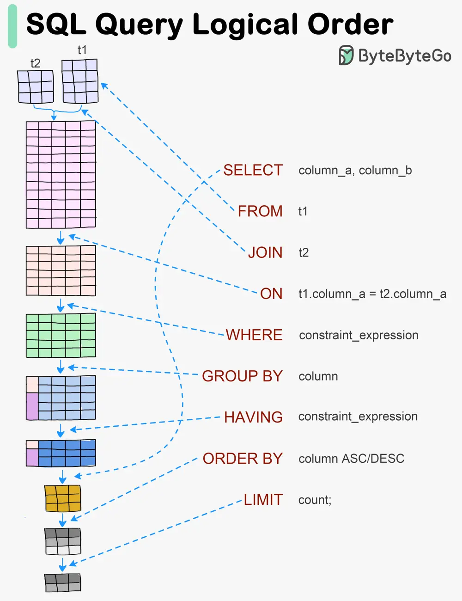

# ByteByteGo System Design 101: Visualizing a SQL Query

> Copied from <https://github.com/ByteByteGoHq/system-design-101> (CC BY-NC-ND 4.0, by ByteByteGo). Questions and answers are the source's own; nothing was answered or rewritten here.

SQL statements are executed by the database system in several steps, including:

*   Parsing the SQL statement and checking its validity

*   Transforming the SQL into an internal representation, such as relational algebra

*   Optimizing the internal representation and creating an execution plan that utilizes index information

*   Executing the plan and returning the results
