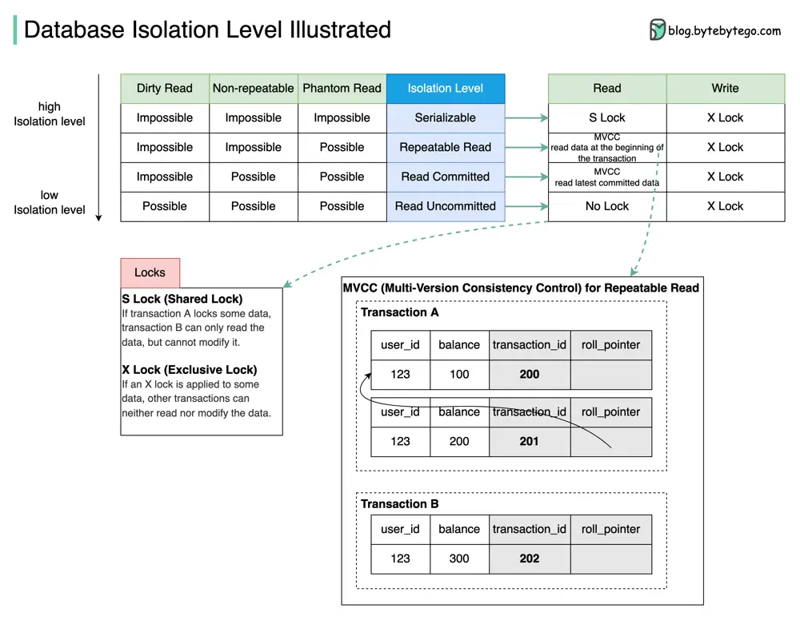

# ByteByteGo System Design 101: Database Isolation Levels

> Copied from <https://github.com/ByteByteGoHq/system-design-101> (CC BY-NC-ND 4.0, by ByteByteGo). Questions and answers are the source's own; nothing was answered or rewritten here.

## What are they used for?

Database isolation allows a transaction to execute as if there are no other concurrently running transactions.

The diagram above illustrates four isolation levels.

## Isolation Levels

*   **Serializable:** This is the highest isolation level. Concurrent transactions are guaranteed to be executed in sequence.

*   **Repeatable Read:** Data read during the transaction stays the same as the transaction starts.

*   **Read Committed:** Data modification can only be read after the transaction is committed.

*   **Read Uncommitted:** The data modification can be read by other transactions before a transaction is committed.

The isolation is guaranteed by MVCC (Multi-Version Consistency Control) and locks.

## MVCC Example

The diagram takes Repeatable Read as an example to demonstrate how MVCC works:

There are two hidden columns for each row: transaction\_id and roll\_pointer. When transaction A starts, a new Read View with transaction\_id=201 is created. Shortly afterward, transaction B starts, and a new Read View with transaction\_id=202 is created.

Now transaction A modifies the balance to 200, a new row of the log is created, and the roll\_pointer points to the old row. Before transaction A commits, transaction B reads the balance data. Transaction B finds that transaction\_id 201 is not committed, it reads the next committed record(transaction\_id=200).

Even when transaction A commits, transaction B still reads data based on the Read View created when transaction B starts. So transaction B always reads the data with balance=100.
