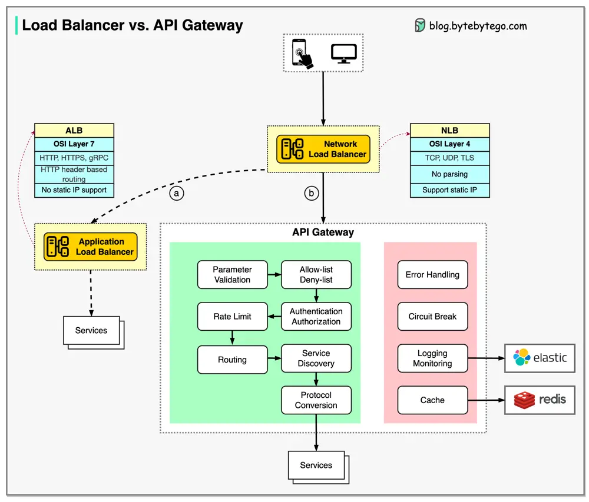

# ByteByteGo System Design 101: Load Balancer vs. API Gateway

> Copied from <https://github.com/ByteByteGoHq/system-design-101> (CC BY-NC-ND 4.0, by ByteByteGo). Questions and answers are the source's own; nothing was answered or rewritten here.

First, let's clarify some concepts before discussing the differences.

*   NLB (Network Load Balancer) is usually deployed before the API gateway, handling traffic routing based on IP. It does not parse the HTTP requests.
*   ALB (Application Load Balancer) routes requests based on HTTP header or URL and thus can provide richer routing rules. We can choose the load balancer based on routing requirements. For simple services with a smaller scale, one load balancer is enough.
*   The API gateway performs tasks more on the application level. So it has different responsibilities from the load balancer.

The diagram above shows the detail. Often, they are used in combination to provide a scalable and secure architecture for modern web apps.

Option a: ALB is used to distribute requests among different services. Due to the fact that the services implement their own rating limitation, authentication, etc., this approach is more flexible but requires more work at the service level.

Option b: An API gateway takes care of authentication, rate limiting, caching, etc., so there is less work at the service level. However, this option is less flexible compared with the ALB approach.
