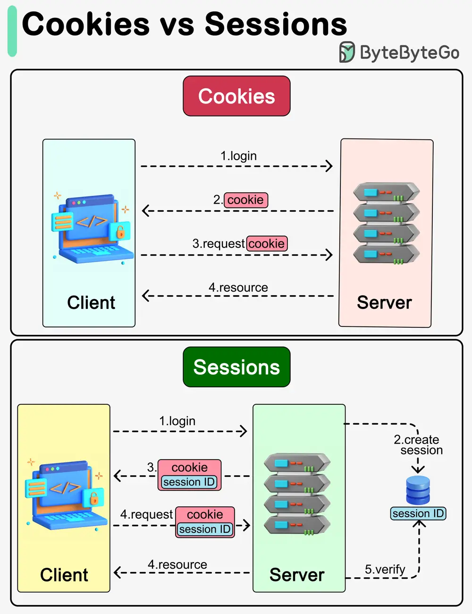

# ByteByteGo System Design 101: Cookies vs Sessions

> Copied from <https://github.com/ByteByteGoHq/system-design-101> (CC BY-NC-ND 4.0, by ByteByteGo). Questions and answers are the source's own; nothing was answered or rewritten here.

Cookies and sessions are both used to carry user information over HTTP requests, including user login status, user permissions, etc.

## Cookies

Cookies typically have size limits (4KB). They carry small pieces of information and are stored on the users’ devices. Cookies are sent with each subsequent user request. Users can choose to ban cookies in their browsers.

## Sessions

Unlike cookies, sessions are created and stored on the server side. There is usually a unique session ID generated on the server, which is attached to a specific user session. This session ID is returned to the client side in a cookie. Sessions can hold larger amounts of data. Since the session data is not directly accessed by the client, the session offers more security.
