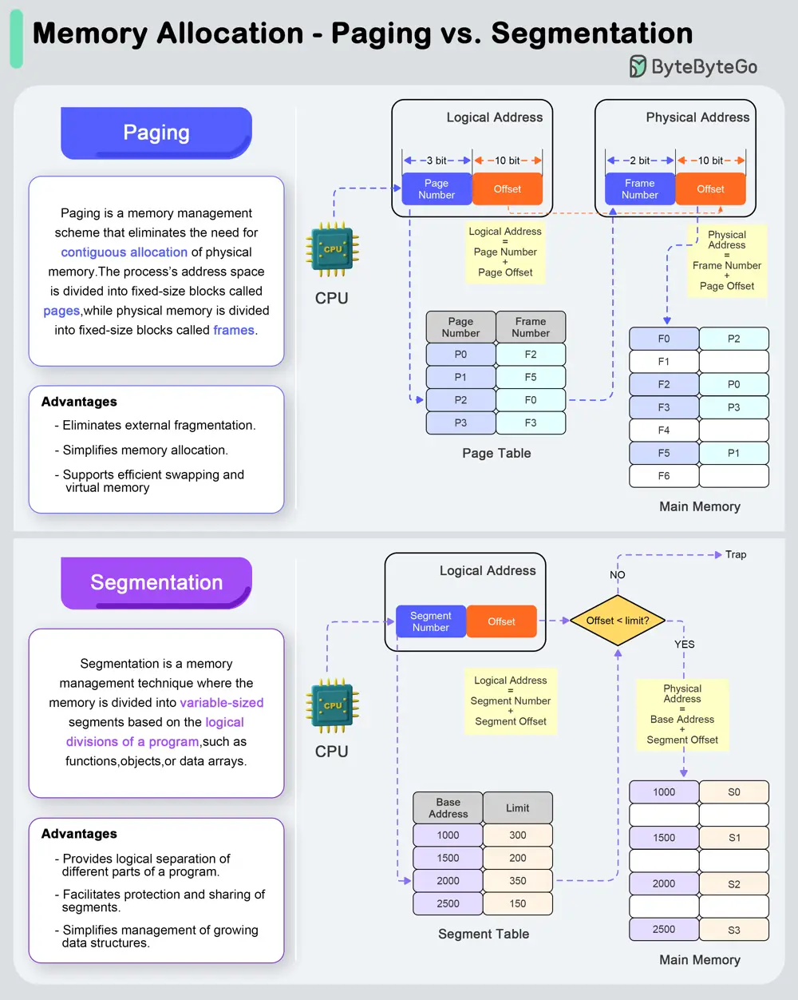

# ByteByteGo System Design 101: Paging vs Segmentation

> Copied from <https://github.com/ByteByteGoHq/system-design-101> (CC BY-NC-ND 4.0, by ByteByteGo). Questions and answers are the source's own; nothing was answered or rewritten here.

## Paging

Paging is a memory management scheme that eliminates the need for contiguous allocation of physical memory. The process's address space is divided into fixed-size blocks called pages, while physical memory is divided into fixed-size blocks called frames.

The address translation process works in 3 steps:

*   Logical Address Space: The logical address (generated by the CPU) is divided into a page number and a page offset.
*   Page Table Lookup: The page number is used as an index into the page table to find the corresponding frame number.
*   Physical Address Formation: The frame number is combined with the page offset to form the physical address in memory.

### Advantages:

*   Eliminates external fragmentation.
*   Simplifies memory allocation.
*   Supports efficient swapping and virtual memory.

## Segmentation

Segmentation is a memory management technique where the memory is divided into variable-sized segments based on the logical divisions of a program, such as functions, objects, or data arrays.

The address tranlation process works in 3 steps:

*   Logical Address Space: The logical address consists of a segment number and an offset within that segment.
*   Segment Table Lookup: The segment number is used as an index into the segment table to find the base address of the segment.
*   Physical Address Formation: The base address is added to the offset to form the physical address in memory.

### Advantages:

*   Provides logical separation of different parts of a program.
*   Facilitates protection and sharing of segments.
*   Simplifies management of growing data structures.
