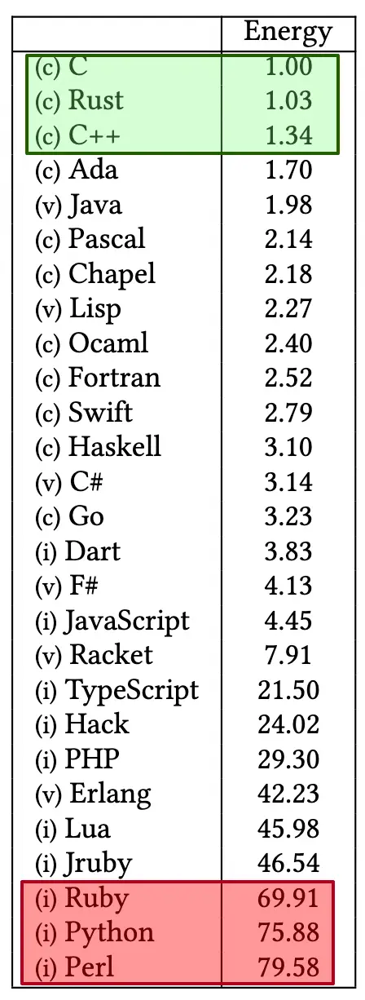

# ByteByteGo System Design 101: What Are the Greenest Programming Languages?

> Copied from <https://github.com/ByteByteGoHq/system-design-101> (CC BY-NC-ND 4.0, by ByteByteGo). Questions and answers are the source's own; nothing was answered or rewritten here.

The study below runs 10 benchmark problems in 28 languages. It measures the runtime, memory usage, and energy consumption of each language. This take might be controversial.

“This paper presents a study of the runtime, memory usage, and energy consumption of twenty-seven well-known software languages. We monitor the performance of such languages using ten different programming problems, expressed in each of the languages. Our results show interesting findings, such as slower/faster languages consuming less/more energy, and how memory usage influences energy consumption. We show how to use our results to provide software engineers support to decide which language to use when energy efficiency is a concern”.
