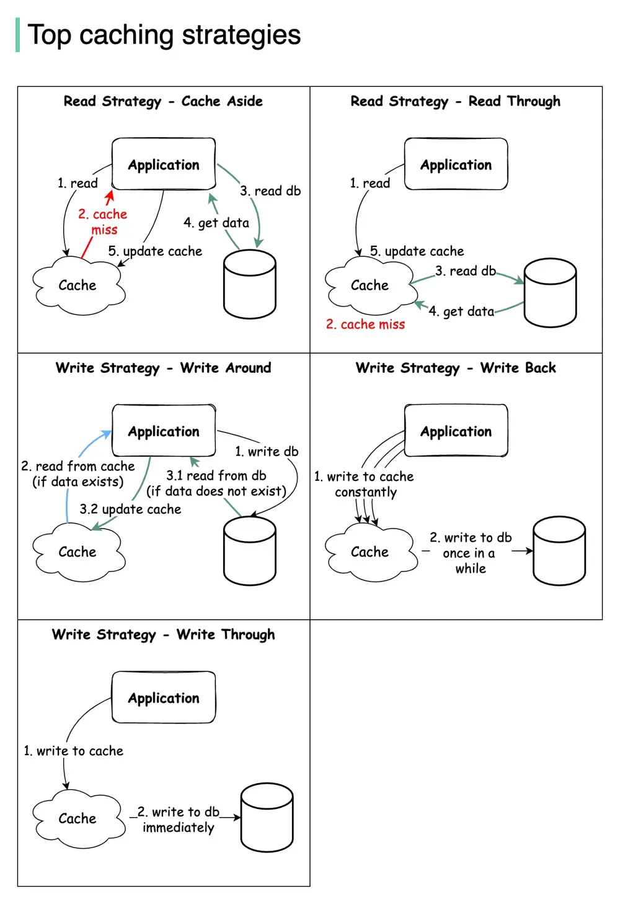

# ByteByteGo System Design 101: Top Caching Strategies

> Copied from <https://github.com/ByteByteGoHq/system-design-101> (CC BY-NC-ND 4.0, by ByteByteGo). Questions and answers are the source's own; nothing was answered or rewritten here.

Read data from the system:

*   **Cache aside**
*   **Read through**

Write data to the system:

*   **Write around**
*   **Write back**
*   **Write through**

The diagram above illustrates how those 5 strategies work. Some of the caching strategies can be used together.

I left out a lot of details as that will make the post very long.

Feel free to leave a comment so we can learn from each other.
