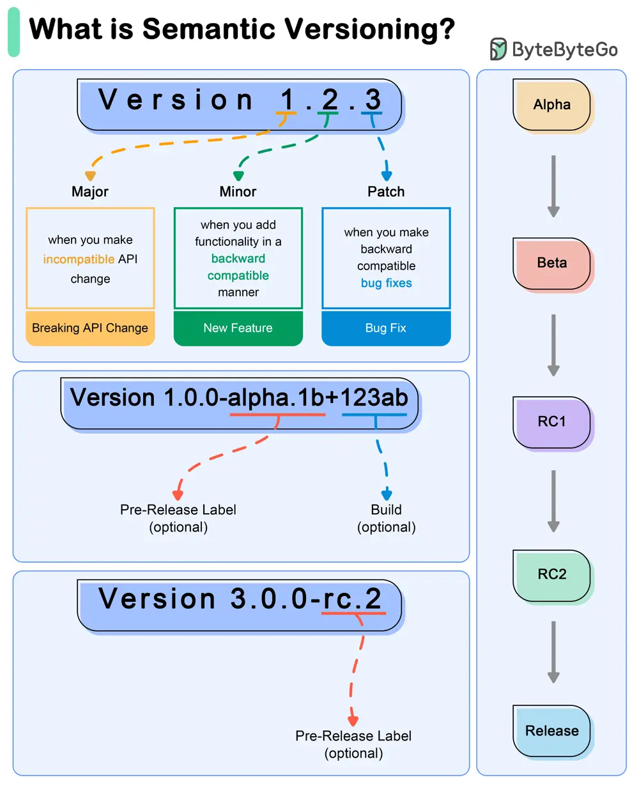

# ByteByteGo System Design 101: What do version numbers mean?

> Copied from <https://github.com/ByteByteGoHq/system-design-101> (CC BY-NC-ND 4.0, by ByteByteGo). Questions and answers are the source's own; nothing was answered or rewritten here.

Semantic Versioning (SemVer) is a versioning scheme for software that aims to convey meaning about the underlying changes in a release.

*   SemVer uses a three-part version number: MAJOR.MINOR.PATCH.
    *   **MAJOR version**: Incremented when there are incompatible API changes.
    *   **MINOR version**: Incremented when functionality is added in a backward-compatible manner.
    *   **PATCH version**: Incremented when backward-compatible bug fixes are made.
*   **Example Workflow**
    *   **Initial Development Phase**
        *   Start with version 0.1.0.
    *   **First Stable Release**
        *   Reach a stable release: 1.0.0.
    *   **Subsequent Changes**
        *   **Patch Release**: A bug fix is needed for 1.0.0. Update to 1.0.1.
        *   **Minor Release**: A new, backward-compatible feature is added to 1.0.3. Update to 1.1.0.
        *   **Major Release**: A significant change that is not backward-compatible is introduced in 1.2.2. Update to 2.0.0.
    *   **Special Versions and Pre-releases**
        *   **Pre-release Versions**: 1.0.0-alpha, 1.0.0-beta, 1.0.0-rc.1.
        *   **Build Metadata**: 1.0.0+20130313144700.
