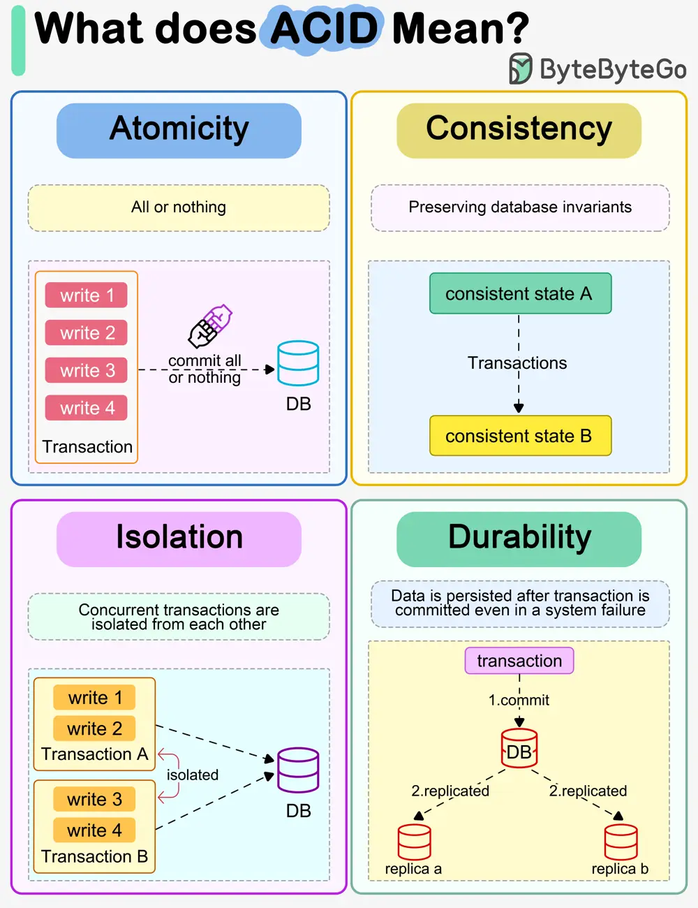

# ByteByteGo System Design 101: What does ACID mean?

> Copied from <https://github.com/ByteByteGoHq/system-design-101> (CC BY-NC-ND 4.0, by ByteByteGo). Questions and answers are the source's own; nothing was answered or rewritten here.

The diagram above explains what ACID means in the context of a database transaction.

## Atomicity

The writes in a transaction are executed all at once and cannot be broken into smaller parts. If there are faults when executing the transaction, the writes in the transaction are rolled back.

So atomicity means “all or nothing”.

## Consistency

Unlike “consistency” in CAP theorem, which means every read receives the most recent write or an error, here consistency means preserving database invariants. Any data written by a transaction must be valid according to all defined rules and maintain the database in a good state.

## Isolation

When there are concurrent writes from two different transactions, the two transactions are isolated from each other. The most strict isolation is “serializability”, where each transaction acts like it is the only transaction running in the database. However, this is hard to implement in reality, so we often adopt loser isolation level.

## Durability

Data is persisted after a transaction is committed even in a system failure. In a distributed system, this means the data is replicated to some other nodes.
