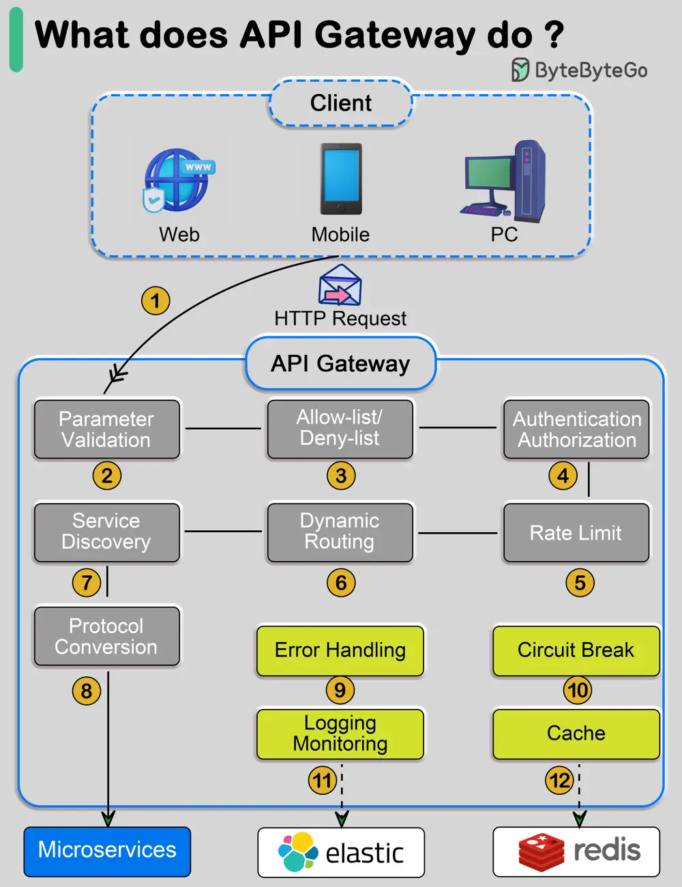

# ByteByteGo System Design 101: What Does an API Gateway Do?

> Copied from <https://github.com/ByteByteGoHq/system-design-101> (CC BY-NC-ND 4.0, by ByteByteGo). Questions and answers are the source's own; nothing was answered or rewritten here.

The diagram above shows the details.

**Step 1** - The client sends an HTTP request to the API gateway.

**Step 2** - The API gateway parses and validates the attributes in the HTTP request.

**Step 3** - The API gateway performs allow-list/deny-list checks.

**Step 4** - The API gateway talks to an identity provider for authentication and authorization.

**Step 5** - The rate limiting rules are applied to the request. If it is over the limit, the request is rejected.

**Steps 6 and 7** - Now that the request has passed basic checks, the API gateway finds the relevant service to route to by path matching.

**Step 8** - The API gateway transforms the request into the appropriate protocol and sends it to backend microservices.

**Steps 9-12** - The API gateway can handle errors properly and deals with faults if the error takes a longer time to recover (circuit break). It can also leverage ELK (Elastic-Logstash-Kibana) stack for logging and monitoring. We sometimes cache data in the API gateway.
