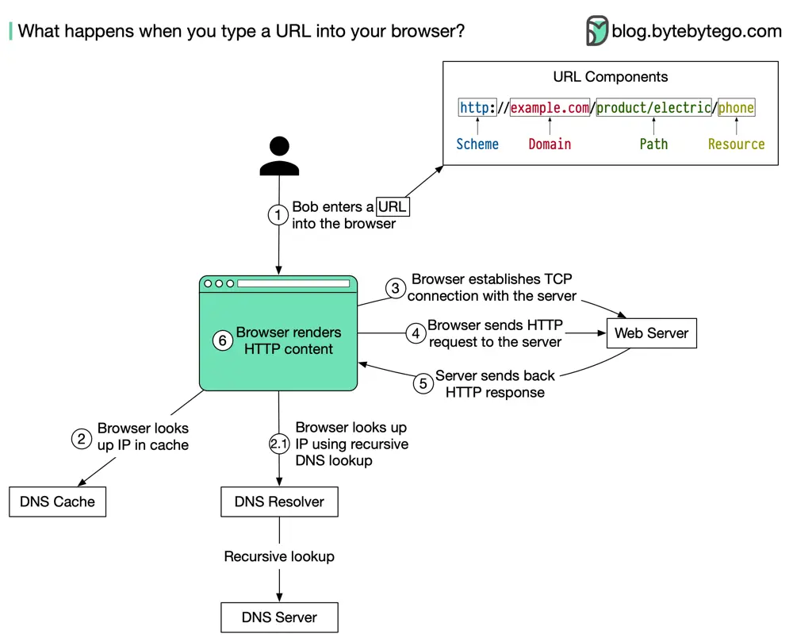

# ByteByteGo System Design 101: What Happens When You Type a URL Into Your Browser?

> Copied from <https://github.com/ByteByteGoHq/system-design-101> (CC BY-NC-ND 4.0, by ByteByteGo). Questions and answers are the source's own; nothing was answered or rewritten here.




The diagram above illustrates the steps.

- Bob enters a URL into the browser and hits Enter. In this example, the URL is composed of 4 parts:
  - **scheme** - *http://*. This tells the browser to send a connection to the server using HTTP.
  - **domain** - *example.com*. This is the domain name of the site.
  - **path** - *product/electric*. It is the path on the server to the requested resource: phone.
  - **resource** - *phone*. It is the name of the resource Bob wants to visit.

- The browser looks up the IP address for the domain with a domain name system (DNS) lookup. To make the lookup process fast, data is cached at different layers: browser cache, OS cache, local network cache, and ISP cache. 
  - If the IP address cannot be found at any of the caches, the browser goes to DNS servers to do a recursive DNS lookup until the IP address is found (this will be covered in another post).

- Now that we have the IP address of the server, the browser establishes a TCP connection with the server.

- The browser sends an HTTP request to the server. The request looks like this:

  ```
  𝘎𝘌𝘛 /𝘱𝘩𝘰𝘯𝘦 𝘏𝘛𝘛𝘗/1.1
  𝘏𝘰𝘴𝘵: 𝘦𝘹𝘢𝘮𝘱𝘭𝘦.𝘤𝘰𝘮
  ```

- The server processes the request and sends back the response. For a successful response (the status code is 200). The HTML response might look like this:

  ```
  𝘏𝘛𝘛𝘗/1.1 200 𝘖𝘒
  𝘋𝘢𝘵𝘦: 𝘚𝘶𝘯, 30 𝘑𝘢𝘯 2022 00:01:01 𝘎𝘔𝘛
  𝘚𝘦𝘳𝘷𝘦𝘳: 𝘈𝘱𝘢𝘤𝘩𝘦
  𝘊𝘰𝘯𝘵𝘦𝘯𝘵-𝘛𝘺𝘱𝘦: 𝘵𝘦𝘹𝘵/𝘩𝘵𝘮𝘭; 𝘤𝘩𝘢𝘳𝘴𝘦𝘵=𝘶𝘵𝘧-8
  
  <**!𝘋𝘖𝘊𝘛𝘠𝘗𝘌** 𝘩𝘵𝘮𝘭>
  <**𝘩𝘵𝘮𝘭** 𝘭𝘢𝘯𝘨="𝘦𝘯">
  𝘏𝘦𝘭𝘭𝘰 𝘸𝘰𝘳𝘭𝘥
  </**𝘩𝘵𝘮𝘭**\>
  ```

- The browser renders the HTML content.
