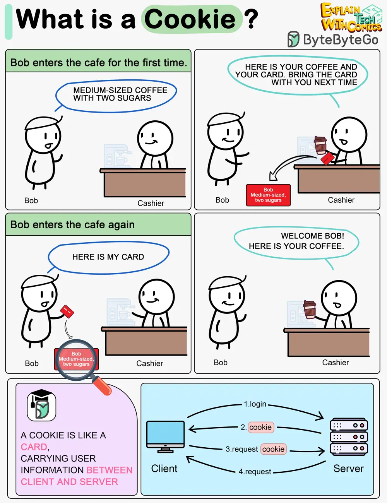

# ByteByteGo System Design 101: What is a Cookie?

> Copied from <https://github.com/ByteByteGoHq/system-design-101> (CC BY-NC-ND 4.0, by ByteByteGo). Questions and answers are the source's own; nothing was answered or rewritten here.

Imagine Bob goes to a coffee shop for the first time, orders a medium-sized espresso with two sugars. The cashier records Bob’s identity and preferences on a card and hands it over to Bob with a cup of coffee.

The next time Bob goes to the cafe, he shows the cashier the preference card. The cashier immediately knows who the customer is and what kind of coffee he likes.

A cookie acts as the preference card. When we log in to a website, the server issues a cookie to us with a small amount of data. The cookie is stored on the client side, so the next time we send a request to the server with the cookie, the server knows our identity and preferences immediately without looking into the database.
