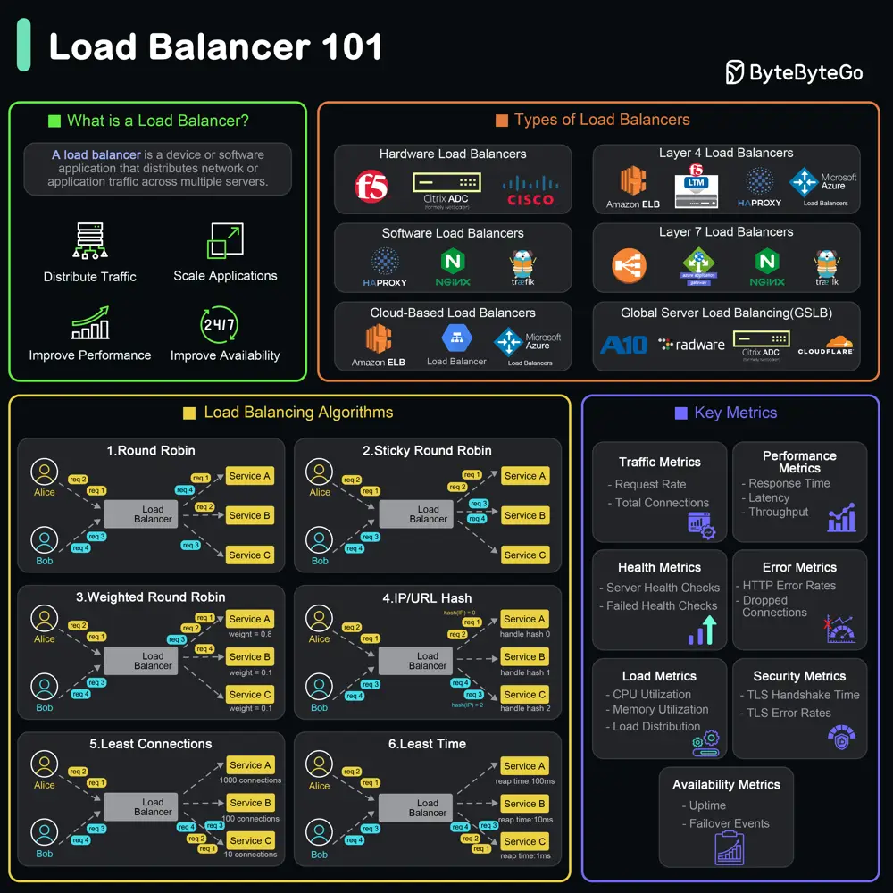

# ByteByteGo System Design 101: What is a Load Balancer?

> Copied from <https://github.com/ByteByteGoHq/system-design-101> (CC BY-NC-ND 4.0, by ByteByteGo). Questions and answers are the source's own; nothing was answered or rewritten here.

A load balancer is a device or software application that distributes network or application traffic across multiple servers.

*   **What Does a Load Balancer Do?**

    *   Distributes Traffic
    *   Ensures Availability and Reliability
    *   Improves Performance
    *   Scales Applications

*   **Types of Load Balancers**

    *   Hardware Load Balancers: These are physical devices designed to distribute traffic across servers.
    *   Software Load Balancers: These are applications that can be installed on standard hardware or virtual machines.
    *   Cloud-based Load Balancers: Provided by cloud service providers, these load balancers are integrated into the cloud infrastructure. Examples include AWS Elastic Load Balancer, Google Cloud Load Balancing, and Azure Load Balancer.
    *   Layer 4 Load Balancers (Transport Layer): Operate at the transport layer (OSI Layer 4) and make forwarding decisions based on IP address and TCP/UDP ports.
    *   Layer 7 Load Balancers (Application Layer): Operate at the application layer (OSI Layer 7).
    *   Global Server Load Balancing (GSLB): Distributes traffic across multiple geographical locations to improve redundancy and performance on a global scale.
