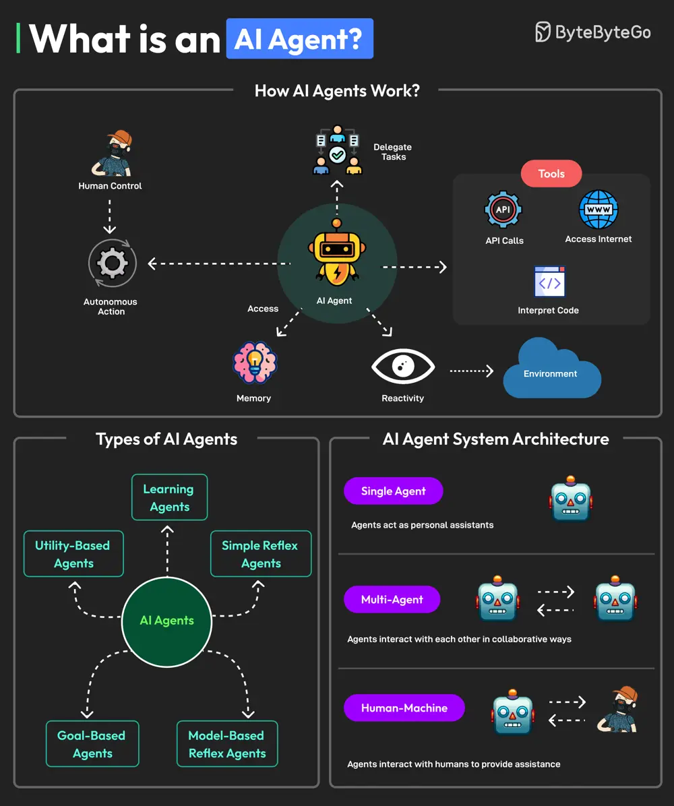

# ByteByteGo System Design 101: What is an AI Agent?

> Copied from <https://github.com/ByteByteGoHq/system-design-101> (CC BY-NC-ND 4.0, by ByteByteGo). Questions and answers are the source's own; nothing was answered or rewritten here.

An AI agent is a software program that can interact with its environment, gather data, and use that data to achieve predetermined goals. AI agents can choose the best actions to perform to meet those goals.

Key characteristics of AI agents are as follows:

*   An agent can perform autonomous actions without constant human intervention. Also, they can have a human in the loop to maintain control.
*   Agents have a memory to store individual preferences and allow for personalization. It can also store knowledge. An LLM can undertake information processing and decision-making functions.
*   Agents must be able to perceive and process the information available from their environment.
*   Agents can also use tools such as accessing the internet, using code interpreters and making API calls.
*   Agents can also collaborate with other agents or humans.

Multiple types of AI agents are available such as learning agents, simple reflex agents, model-based reflex agents, goal-based agents, and utility-based agents.

A system with AI agents can be built with different architectural approaches.

1.  **Single Agent**: Agents can serve as personal assistants.
2.  **Multi-Agent**: Agents can interact with each other in collaborative or competitive ways.
3.  **Human Machine**: Agents can interact with humans to execute tasks more efficiently.
