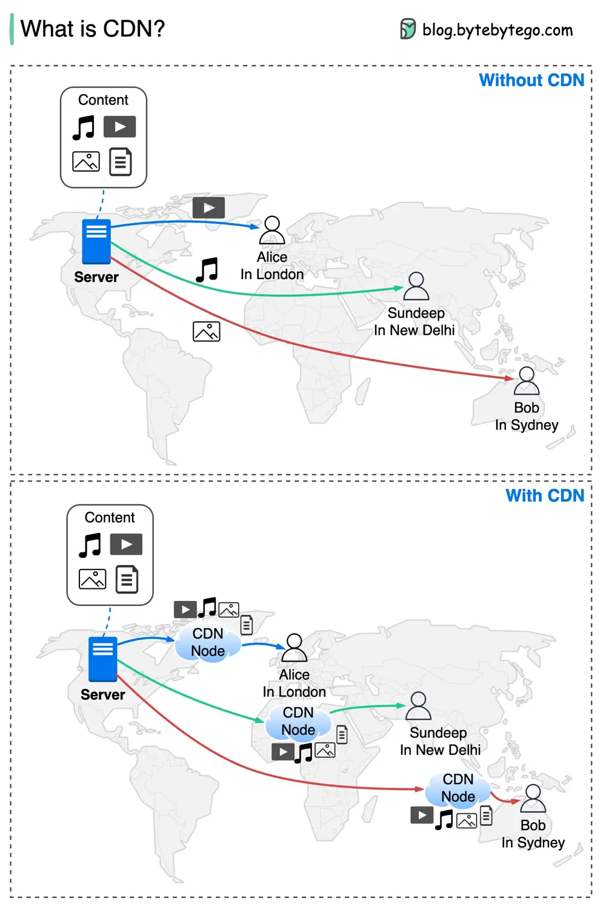

# ByteByteGo System Design 101: What is CDN (Content Delivery Network)?

> Copied from <https://github.com/ByteByteGoHq/system-design-101> (CC BY-NC-ND 4.0, by ByteByteGo). Questions and answers are the source's own; nothing was answered or rewritten here.

How does CDN make content delivery faster? The diagram above shows why.

A CDN refers to geographically distributed servers (also called edge servers) that provide fast delivery of **static and dynamic content**.

With CDN, users don’t need to retrieve content (music, video, files, pictures, etc.) from the origin server. Instead, the content is cached at CDN nodes around the globe, and users can retrieve the content from nearby CDN nodes.

## The benefits of CDN are:

*   Reducing latency

*   Reducing bandwidth

*   Improving website security, especially protecting against DDoS (Distributed Denial-of-Service) attack

*   Increasing content availability
