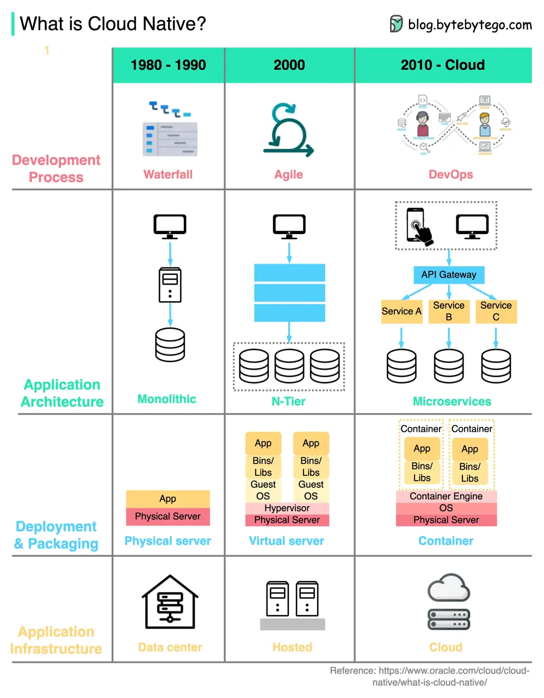

# ByteByteGo System Design 101: What is Cloud Native?

> Copied from <https://github.com/ByteByteGoHq/system-design-101> (CC BY-NC-ND 4.0, by ByteByteGo). Questions and answers are the source's own; nothing was answered or rewritten here.

Below is a diagram showing the evolution of architecture and processes since the 1980s.

Organizations can build and run scalable applications on public, private, and hybrid clouds using cloud native technologies.

This means the applications are designed to leverage cloud features, so they are resilient to load and easy to scale.

Cloud native includes 4 aspects:

*   **Development process**

    This has progressed from waterfall to agile to DevOps.

*   **Application Architecture**

    The architecture has gone from monolithic to microservices. Each service is designed to be small, and adaptive to the limited resources in cloud containers.

*   **Deployment & packaging**

    The applications used to be deployed on physical servers. Then around 2000, the applications that were not sensitive to latency were usually deployed on virtual servers. With cloud native applications, they are packaged into docker images and deployed in containers.

*   **Application infrastructure**

    The applications are massively deployed on cloud infrastructure instead of self-hosted servers.
