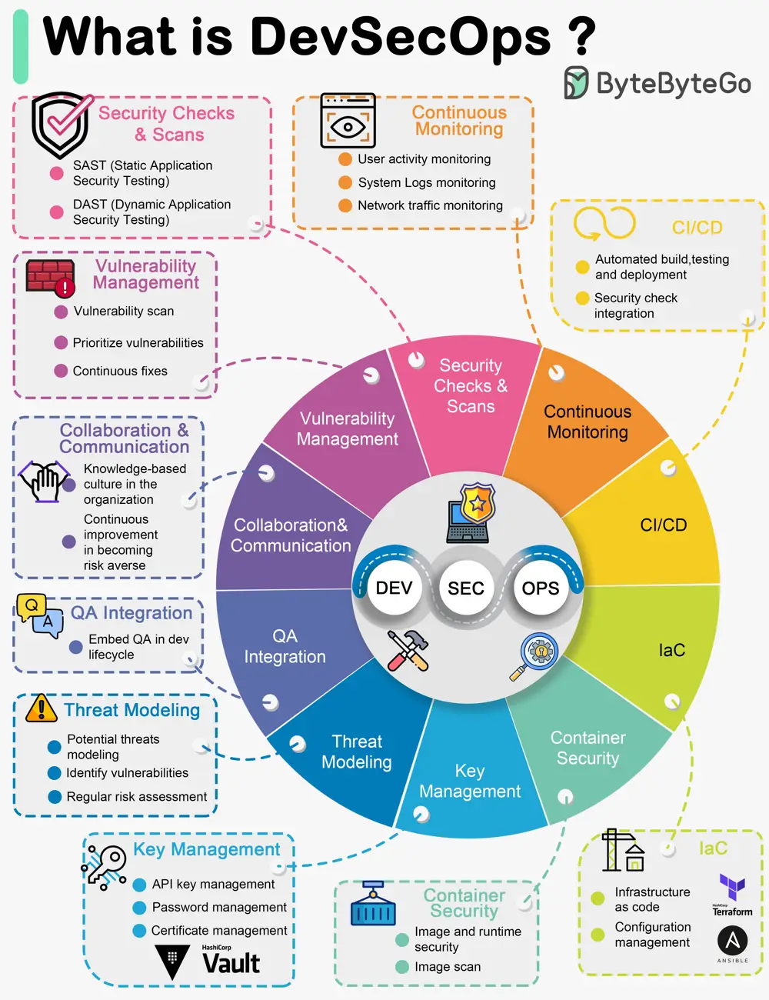

# ByteByteGo System Design 101: What is DevSecOps?

> Copied from <https://github.com/ByteByteGoHq/system-design-101> (CC BY-NC-ND 4.0, by ByteByteGo). Questions and answers are the source's own; nothing was answered or rewritten here.

DevSecOps emerged as a natural evolution of DevOps practices with a focus on integrating security into the software development and deployment process. The term "DevSecOps" represents the convergence of Development (Dev), Security (Sec), and Operations (Ops) practices, emphasizing the importance of security throughout the software development lifecycle.

The diagram below shows the important concepts in DevSecOps.

## Key Concepts in DevSecOps

*   Automated Security Checks

*   Continuous Monitoring

*   CI/CD Automation

*   Infrastructure as Code (IaC)

*   Container Security

*   Secret Management

*   Threat Modeling

*   Quality Assurance (QA) Integration

*   Collaboration and Communication

*   Vulnerability Management
