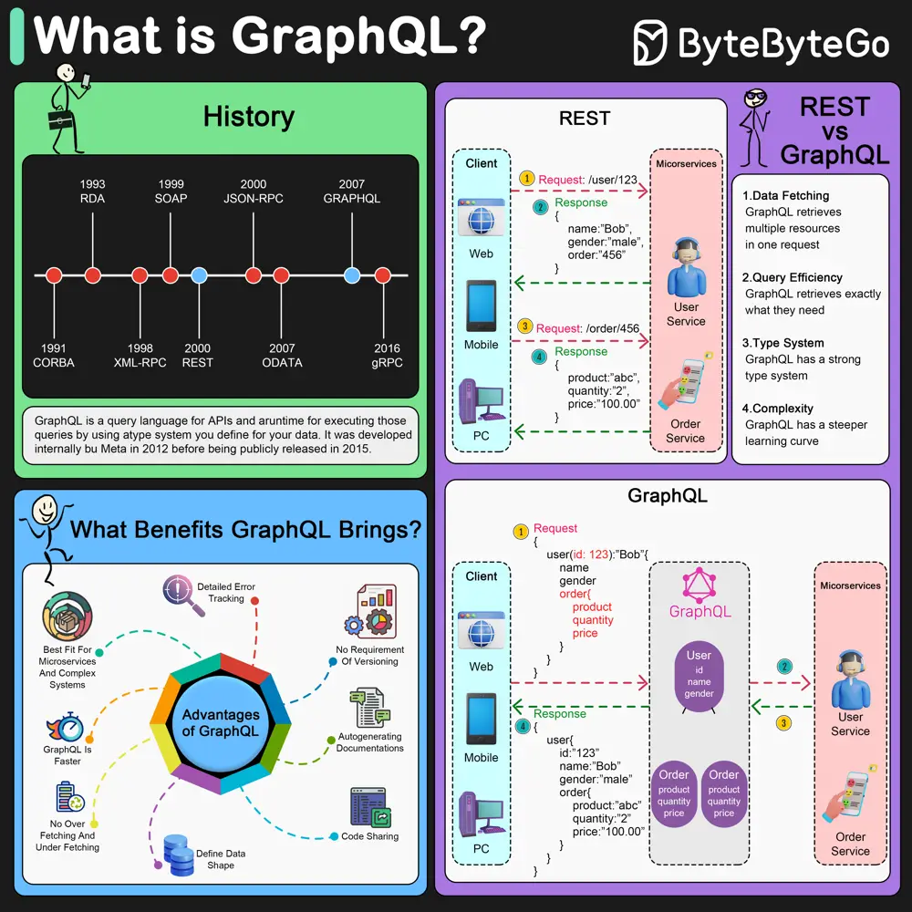

# ByteByteGo System Design 101: What is GraphQL?

> Copied from <https://github.com/ByteByteGoHq/system-design-101> (CC BY-NC-ND 4.0, by ByteByteGo). Questions and answers are the source's own; nothing was answered or rewritten here.

### Is it a replacement for the REST API?

GraphQL is a query language for APIs and a runtime for executing those queries by using a type system you define for your data. It was developed internally by Meta in 2012 before being publicly released in 2015.

Unlike the more traditional REST API, GraphQL allows clients to request exactly the data they need, making it possible to fetch data from multiple sources with a single query. This efficiency in data retrieval can lead to improved performance for web and mobile applications.

GraphQL servers sit in between the client and the backend services. It can aggregate multiple REST requests into one query. GraphQL server organizes the resources in a graph.

GraphQL supports queries, mutations (applying data modifications to resources), and subscriptions (receiving notifications on schema modifications).

**Benefits of GraphQL:**

*   GraphQL is more efficient in data fetching.
*   GraphQL returns more accurate results.
*   GraphQL has a strong type system to manage the structure of entities, reducing errors.
*   GraphQL is suitable for managing complex microservices.

**Disadvantages of GraphQL**

*   Increased complexity.
*   Over fetching by design
*   Caching complexity
