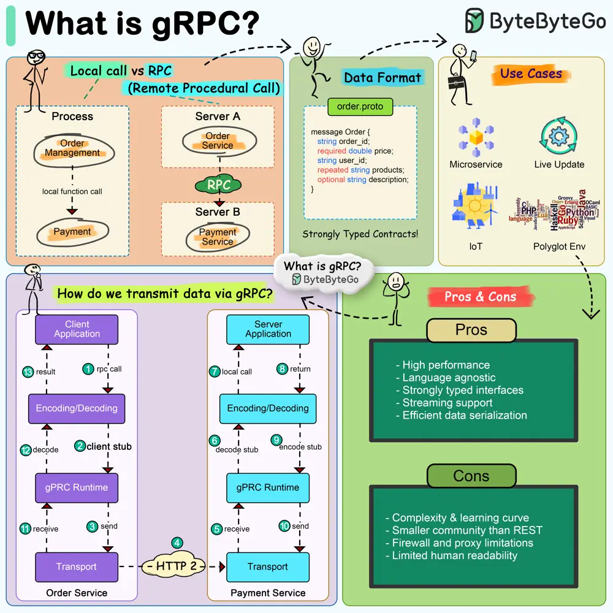

# ByteByteGo System Design 101: What is gRPC?

> Copied from <https://github.com/ByteByteGoHq/system-design-101> (CC BY-NC-ND 4.0, by ByteByteGo). Questions and answers are the source's own; nothing was answered or rewritten here.

gRPC is a high-performance, open-source universal RPC (Remote Procedure Call) framework initially developed by Google. It leverages HTTP/2 for transport, Protocol Buffers as the interface description language, and provides features such as authentication, load balancing, and more.

gRPC is designed to enable efficient and robust communication between services in a microservices architecture, making it a popular choice for building distributed systems and APIs.

**Key Features of gRPC:**

*   **Protocol Buffers:** By default, gRPC uses Protocol Buffers (proto files) as its interface definition language (IDL). This makes gRPC messages smaller and faster compared to JSON or XML.
*   **HTTP/2 Based Transport:** gRPC uses HTTP/2 for transport, which allows for many improvements over HTTP/1.x.
*   **Multiple Language Support:** gRPC supports a wide range of programming languages.
*   **Bi-Directional Streaming:** gRPC supports streaming requests and responses, allowing for the development of sophisticated real-time applications with bidirectional communication like chat services.
