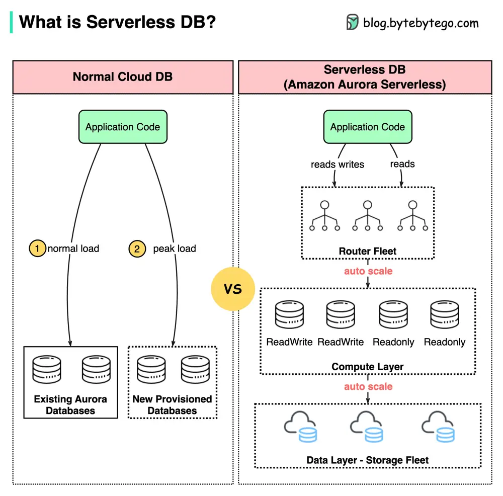

# ByteByteGo System Design 101: What is Serverless DB?

> Copied from <https://github.com/ByteByteGoHq/system-design-101> (CC BY-NC-ND 4.0, by ByteByteGo). Questions and answers are the source's own; nothing was answered or rewritten here.

Are serverless databases the future? How do serverless databases differ from traditional cloud databases?

Amazon Aurora Serverless, depicted in the diagram above, is a configuration that is auto-scaling and available on-demand for Amazon Aurora.

## Key Features of Aurora Serverless

*   Aurora Serverless has the ability to scale capacity automatically up or down as per business requirements. For example, an eCommerce website preparing for a major promotion can scale the load to multiple databases within a few milliseconds. In comparison to regular cloud databases, which necessitate the provision and administration of database instances, Aurora Serverless can automatically start up and shut down.

*   By decoupling the compute layer from the data storage layer, Aurora Serverless is able to charge fees in a more precise manner. Additionally, Aurora Serverless can be a combination of provisioned and serverless instances, enabling existing provisioned databases to become a part of the serverless pool.
