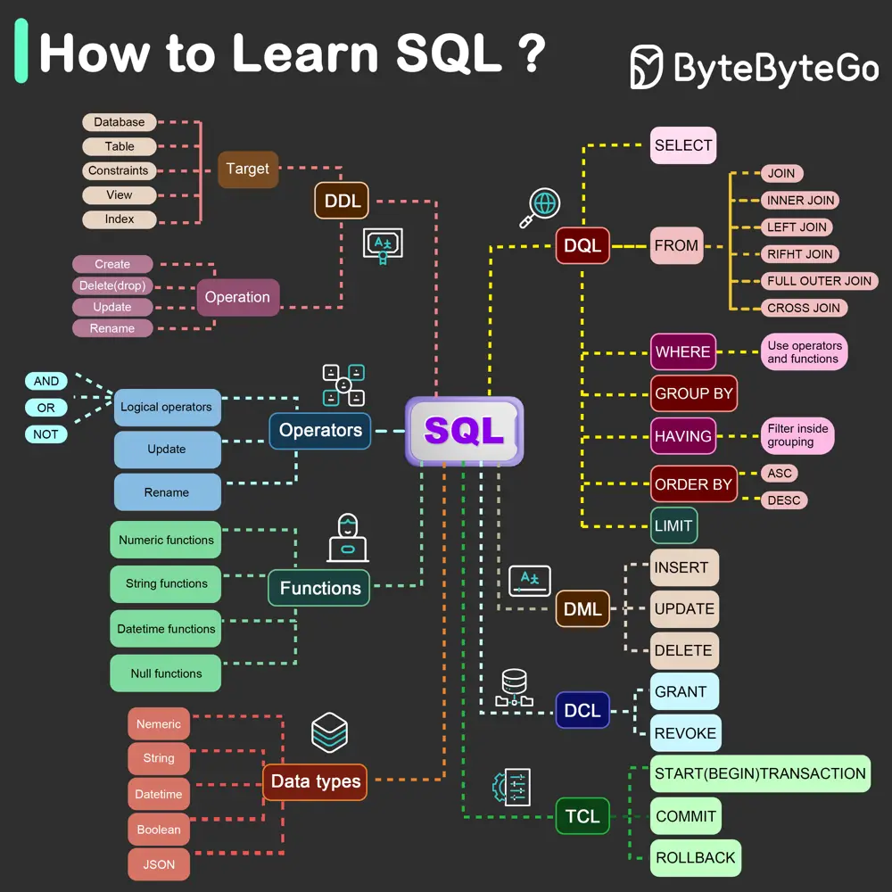

# ByteByteGo System Design 101: What is the Best Way to Learn SQL?

> Copied from <https://github.com/ByteByteGoHq/system-design-101> (CC BY-NC-ND 4.0, by ByteByteGo). Questions and answers are the source's own; nothing was answered or rewritten here.

In 1986, SQL (Structured Query Language) became a standard. Over the next 40 years, it became the dominant language for relational database management systems. Reading the latest standard (ANSI SQL 2016) can be time-consuming. How can I learn it?

## SQL Components

There are 5 components of the SQL language:

*   **DDL**: data definition language, such as CREATE, ALTER, DROP

*   **DQL**: data query language, such as SELECT

*   **DML**: data manipulation language, such as INSERT, UPDATE, DELETE

*   **DCL**: data control language, such as GRANT, REVOKE

*   **TCL**: transaction control language, such as COMMIT, ROLLBACK

For a backend engineer, you may need to know most of it. As a data analyst, you may need to have a good understanding of DQL. Select the topics that are most relevant to you.
