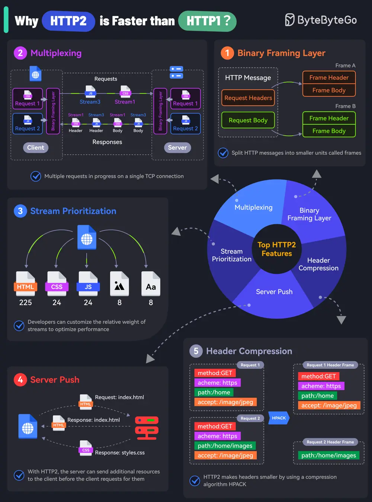

# ByteByteGo System Design 101: What makes HTTP2 faster than HTTP1?

> Copied from <https://github.com/ByteByteGoHq/system-design-101> (CC BY-NC-ND 4.0, by ByteByteGo). Questions and answers are the source's own; nothing was answered or rewritten here.

The key features of HTTP2 play a big role in this. Let’s look at them:

*   **Binary Framing Layer**
    HTTP2 encodes the messages into binary format.
    This allows the messages into smaller units called frames, which are then sent over the TCP connection, resulting in more efficient processing.
*   **Multiplexing**
    The Binary Framing allows full request and response multiplexing.
    Clients and servers can interleave frames during transmissions and reassemble them on the other side.
*   **Stream Prioritization**
    With stream prioritization, developers can customize the relative weight of requests or streams to make the server send more frames for higher-priority requests.
*   **Server Push**
    Since HTTP2 allows multiple concurrent responses to a client’s request, a server can send additional resources along with the requested page to the client.
*   **HPACK Header Compression**
    HTTP2 uses a special compression algorithm called HPACK to make the headers smaller for multiple requests, thereby saving bandwidth.

Of course, despite these features, HTTP2 can also be slow depending on the exact technical scenario. Therefore, developers need to test and optimize things to maximize the benefits of HTTP2.
