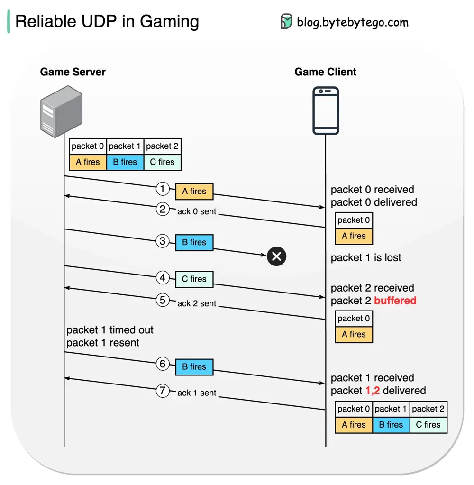

# ByteByteGo System Design 101: TCP vs UDP for Online Gaming

> Copied from <https://github.com/ByteByteGoHq/system-design-101> (CC BY-NC-ND 4.0, by ByteByteGo). Questions and answers are the source's own; nothing was answered or rewritten here.

A common practice is to use RUDP (Reliable UDP). It adds a **reliable** mechanism on top of UDP to provide **much lower latency** than TCP and guarantee accuracy.

The diagram below shows how reliable data delivery is implemented in online gaming to get eventually-synchronized states.

Suppose there is a big fight in a simulation shooter game. Characters A, B, and C open fires in sequence. How does the game server transmit the states from the game server to the game client?

*   **Steps 1 and 2** - Character A opens fires. The packet (packet 0) is sent to the client. The client acknowledges the server.

*   **Step 3** - Character B opens fire. The packet is lost during transmission.

*   **Steps 4 and 5** - Character C opens fire. The packet (packet 2) is sent to the client. Since the last successfully delivered packet is packet 0, the client knows that packet 1 is lost, so packet 2 is **buffered** on the client side. The client acknowledges the server for the reception of packet 2.

*   **Steps 6 and 7** - The server doesn’t receive the ack for packet 1 for a while, so it resends packet 1. When the client receives packet 1, all the subsequent packets become effective, so packets 1 and 2 become “**delivered**”. The client then acknowledges the server for the reception of packet 1. No packets are buffered at this point.
