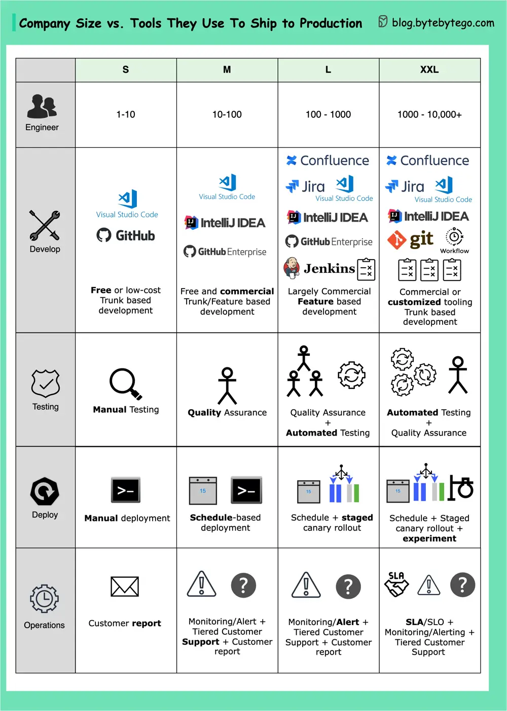

# ByteByteGo System Design 101: Tools for Shipping Code to Production

> Copied from <https://github.com/ByteByteGoHq/system-design-101> (CC BY-NC-ND 4.0, by ByteByteGo). Questions and answers are the source's own; nothing was answered or rewritten here.

The approach generally depends on the size of the company. There is no one-size-fits-all solution, but we try to provide a general overview.

## 1-10 employees

In the early stages of a company, the focus is on finding a product-market fit. The emphasis is primarily on delivery and experimentation. Utilizing existing free or low-cost tools, developers handle testing and deployment. They also pay close attention to customer feedback and reports.

## 10-100 employees

Once the product-market fit is found, companies strive to scale. They are able to invest more in quality for critical functionalities and can create rapid evolution processes, such as scheduled deployments and testing procedures. Companies also proactively establish customer support processes to handle customer issues and provide proactive alerts.

## 100-1,000 employees

When a company's go-to-market strategy proves successful, and the product scales and grows rapidly, it starts to optimize its engineering efficiency. More commercial tools can be purchased, such as Atlassian products. A certain level of standardization across tools is introduced, and automation comes into play.

## 1,000-10,000+ employees

Large tech companies build experimental tooling and automation to ensure quality and gather customer feedback at scale. Netflix, for example, is well known for its "Test in Production" strategy, which conducts everything through experiments.
