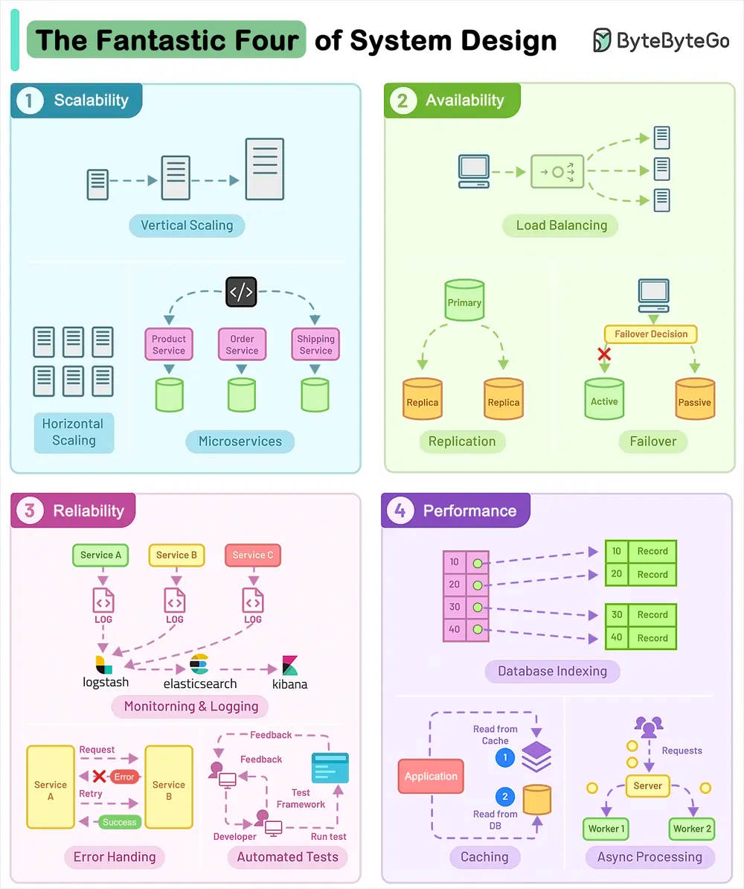

# ByteByteGo System Design 101: The Fantastic Four of System Design

> Copied from <https://github.com/ByteByteGoHq/system-design-101> (CC BY-NC-ND 4.0, by ByteByteGo). Questions and answers are the source's own; nothing was answered or rewritten here.

Scalability, Availability, Reliability, and Performance. They are the most critical components to crafting successful software systems.

Let’s look at each of them with implementation techniques:

*   **Scalability**

    Scalability ensures that your application can handle more load without compromising performance.

*   **Availability**

    Availability makes sure that your application is always ready to serve the users and downtime is minimal.

*   **Reliability**

    Reliability is about building software that consistently delivers correct results.

*   **Performance**

    Performance is the ability of a system to carry out its tasks at an expected rate under peak load using available resources.
