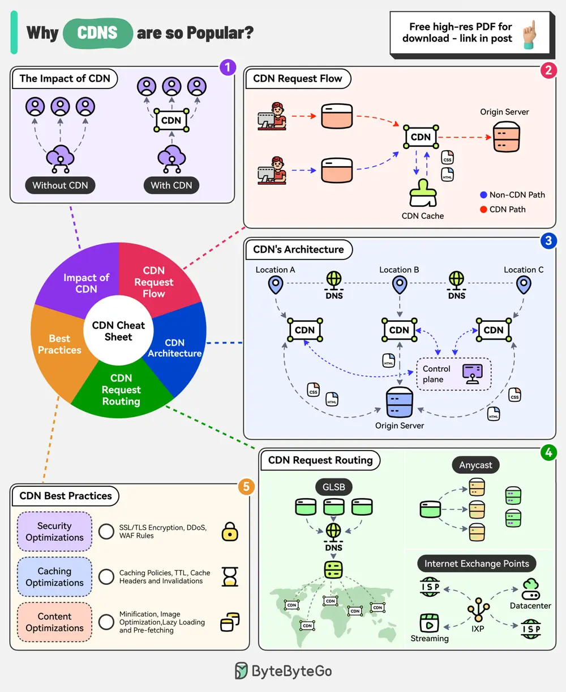

# ByteByteGo System Design 101: Why are Content Delivery Networks (CDN) so Popular?

> Copied from <https://github.com/ByteByteGoHq/system-design-101> (CC BY-NC-ND 4.0, by ByteByteGo). Questions and answers are the source's own; nothing was answered or rewritten here.

The CDN market is expected to reach nearly $38 billion by 2028. Companies like Akamai, Cloudflare, and Amazon CloudFront are investing heavily in this area.

## The Impact of CDN

CDNs improve performance, increase availability, and enhance bandwidth costs. With the use of CDN, there is a significant reduction in latency.

## CDN Request Flow

After DNS resolution, the user’s device sends the content request to the CDN edge server.

*   The edge server checks its local cache for the content. If found, the edge server serves the content to the user.

*   If not found, the edge server forwards the request to the origin server.

*   After receiving the content from the origin server, the edge server stores a copy in its cache and delivers it to the user.

## The Architecture of CDN

There are multiple components in a CDN’s architecture:

*   **Origin Server:** This is the primary source of content.

*   **Edge Servers:** They cache and server content to the users and are distributed across the world.

*   **DNS:** The DNS resolves the domain name to the IP address of the nearest edge server

*   **Control Plane:** Responsible for configuring and managing the edge servers.

## CDN Request Routing

*   **GSLB:** Routes user requests to the server based on factors like geographic proximity, server load, network conditions

*   **Anycast DNS:** Allows multiple servers to share the same IP address. It helps route incoming traffic to the nearest data center.

*   **Internet Exchange Points:** CDN providers establish a presence at major IXPs, allowing them to exchange traffic directly with ISPs and other networks.

## Best Practices

Some key best practices to optimize CDN performance are related to security aspects, caching optimizations, and content optimizations.
