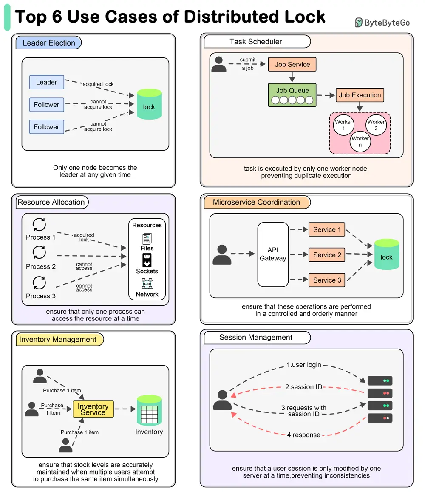

# ByteByteGo System Design 101: Why Use a Distributed Lock?

> Copied from <https://github.com/ByteByteGoHq/system-design-101> (CC BY-NC-ND 4.0, by ByteByteGo). Questions and answers are the source's own; nothing was answered or rewritten here.

A distributed lock is a mechanism that ensures mutual exclusion across a distributed system.

## Top 6 Use Cases for Distributed Locks

*   **Leader Election**

    Distributed locks can be used to ensure that only one node becomes the leader at any given time.

*   **Task Scheduling**

    In a distributed task scheduler, distributed locks ensure that a scheduled task is executed by only one worker node, preventing duplicate execution.

*   **Resource Allocation**

    When managing shared resources like file systems, network sockets, or hardware devices, distributed locks ensure that only one process can access the resource at a time.

*   **Microservices Coordination**

    When multiple microservices need to perform coordinated operations, such as updating related data in different databases, distributed locks ensure that these operations are performed in a controlled and orderly manner.

*   **Inventory Management**

    In e-commerce platforms, distributed locks can manage inventory updates to ensure that stock levels are accurately maintained when multiple users attempt to purchase the same item simultaneously.

*   **Session Management**

    When handling user sessions in a distributed environment, distributed locks can ensure that a user session is only modified by one server at a time, preventing inconsistencies.
