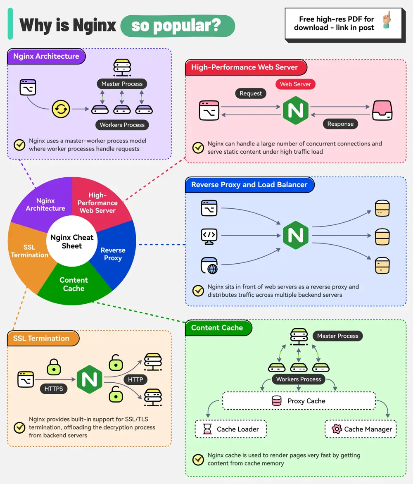

# ByteByteGo System Design 101: Why is Nginx so Popular?

> Copied from <https://github.com/ByteByteGoHq/system-design-101> (CC BY-NC-ND 4.0, by ByteByteGo). Questions and answers are the source's own; nothing was answered or rewritten here.

Nginx is a high-performance web server and reverse proxy.

It follows a master-worker process model that contributes to its stability, scalability, and efficient resource utilization.

The master process is responsible for reading the configuration and managing worker processes. Worker processes handle incoming connections using an event-driven non-blocking I/O model.

Due to its architecture, Nginx excels in supporting multiple features such as:

*   **High-Performance Web Server**
*   **Reverse Proxy and Load Balancing**
*   **Content Cache**
*   **SSL Termination**
