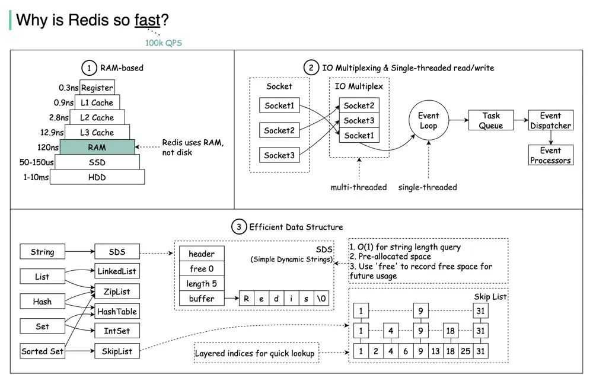

# ByteByteGo System Design 101: Why is Redis so Fast?

> Copied from <https://github.com/ByteByteGoHq/system-design-101> (CC BY-NC-ND 4.0, by ByteByteGo). Questions and answers are the source's own; nothing was answered or rewritten here.

There are 3 main reasons as shown in the diagram above.

*   Redis is a RAM-based database. RAM access is at least 1000 times faster than random disk access.

*   Redis leverages IO multiplexing and single-threaded execution loop for execution efficiency.

*   Redis leverages several efficient lower-level data structures.
