# DBMS layers: full map, CMU 15-445 L01–L07

**What it's for:** quick revision of everything in lectures 1–7, layer by layer, with every option the course lists. Read the diagrams top to bottom: the same order a query travels, from SQL down to the disk.

> **Source:** CMU 15-445/645 Fall 2025, notes and slides for [L01](https://15445.courses.cs.cmu.edu/fall2025/notes/01-relationalmodel.pdf) · [L02](https://15445.courses.cs.cmu.edu/fall2025/notes/02-modernsql.pdf) · [L03](https://15445.courses.cs.cmu.edu/fall2025/notes/03-storage1.pdf) · [L04](https://15445.courses.cs.cmu.edu/fall2025/notes/04-bufferpool.pdf) · [L05](https://15445.courses.cs.cmu.edu/fall2025/notes/05-storage2.pdf) · [L06](https://15445.courses.cs.cmu.edu/fall2025/notes/06-storage3.pdf) · [L07](https://15445.courses.cs.cmu.edu/fall2025/notes/07-hashtables.pdf) (slides: same names under `/slides/`). Nothing here comes from outside those files. A line marked *(slides)* is only on the slides, not in the notes.

**Contents**
1. [The whole stack](#1-the-whole-stack)
2. [L01: relational model and algebra](#2-l01-relational-model-and-algebra)
3. [L02: modern SQL](#3-l02-modern-sql)
4. [L03: storage hierarchy](#4-l03-storage-hierarchy)
5. [L03: files and pages](#5-l03-files-and-pages)
6. [L03/L05: the three page layouts](#6-l03l05-the-three-page-layouts)
7. [L03: tuple layout and data representation](#7-l03-tuple-layout-and-data-representation)
8. [L05: tuple-oriented storage, step by step](#8-l05-tuple-oriented-storage-step-by-step)
9. [L05: log-structured storage](#9-l05-log-structured-storage)
10. [L06: workloads and storage models](#10-l06-workloads-and-storage-models)
11. [L06: compression](#11-l06-compression)
12. [L04: buffer pool](#12-l04-buffer-pool)
13. [L04: why not the OS (mmap)](#13-l04-why-not-the-os-mmap)
14. [L04: replacement policies](#14-l04-replacement-policies)
15. [L04: dirty pages, I/O scheduling, OS cache, fsync](#15-l04-dirty-pages-io-scheduling-os-cache-fsync)
16. [L04/L05: buffer pool optimizations](#16-l04l05-buffer-pool-optimizations)
17. [L07: hash tables](#17-l07-hash-tables)
18. [One-page recap](#18-one-page-recap)

---

## 1. The whole stack

The layers are from the L03 "Course outline" slide. Query planning, operator execution, concurrency control and recovery come after L07, so they are only named here.

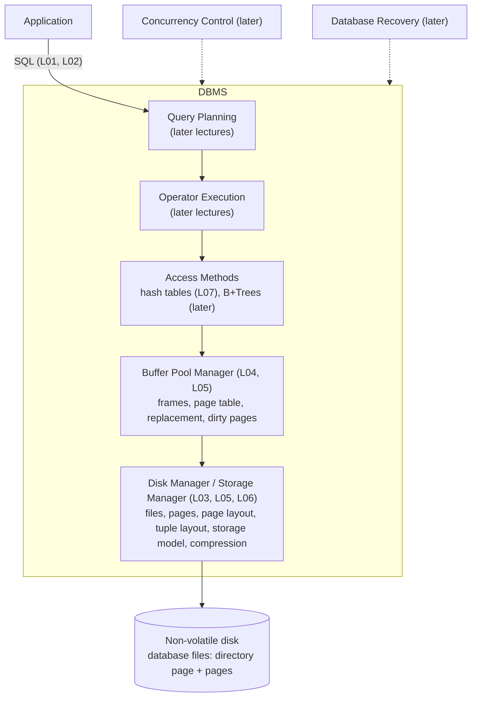

How one request moves through it (L03 §4 "Disk-oriented DBMS overview"):

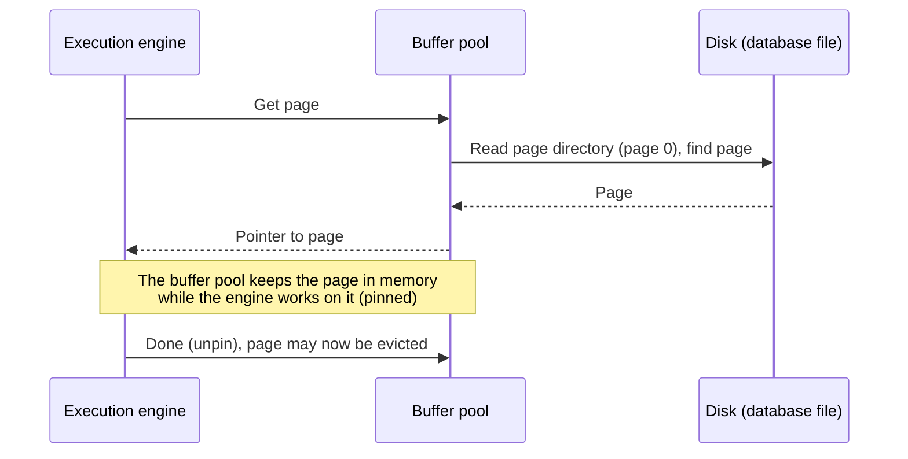

---

## 2. L01: relational model and algebra

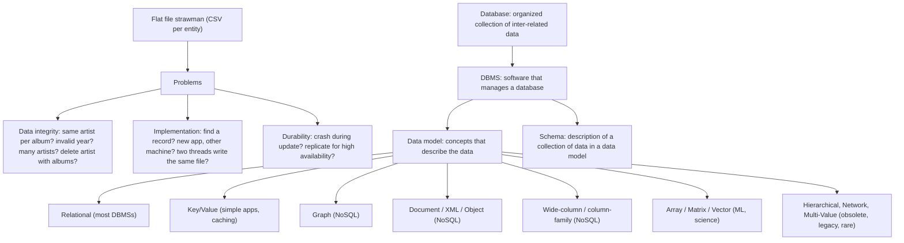

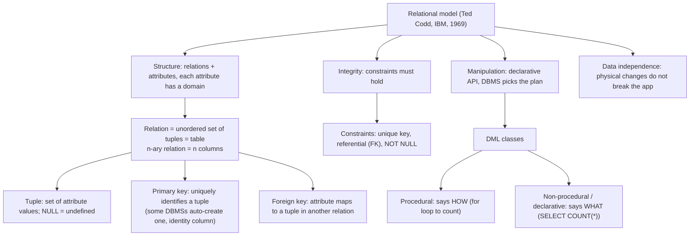

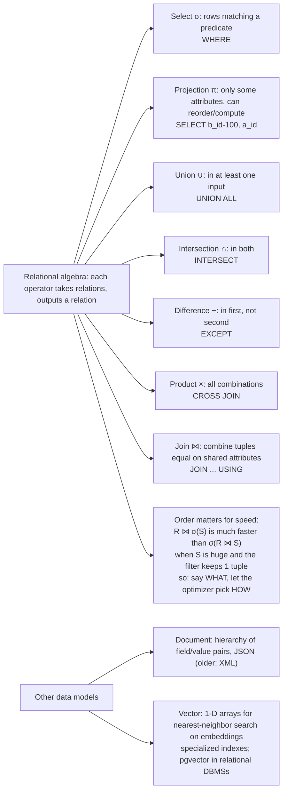

---

## 3. L02: modern SQL

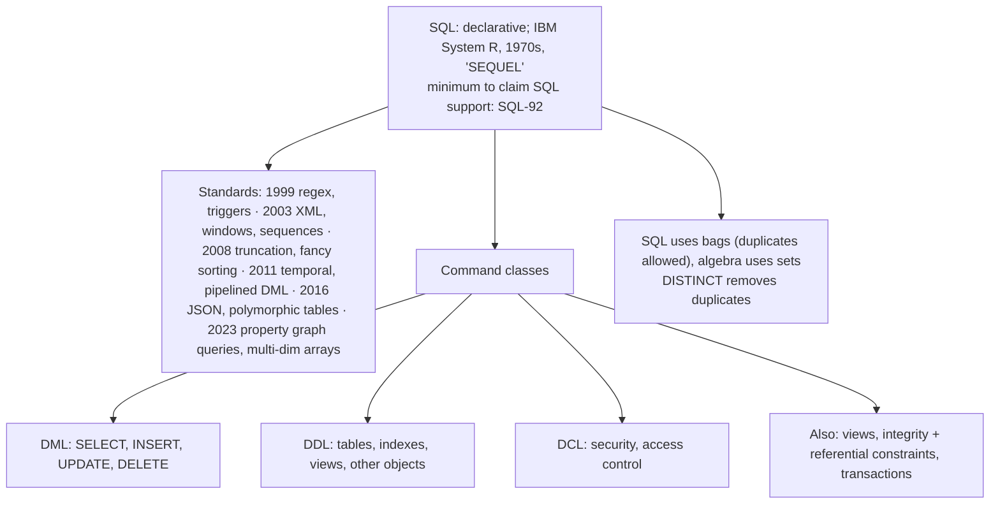

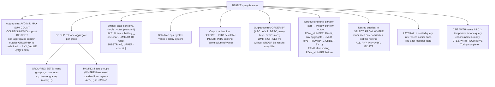

---

## 4. L03: storage hierarchy

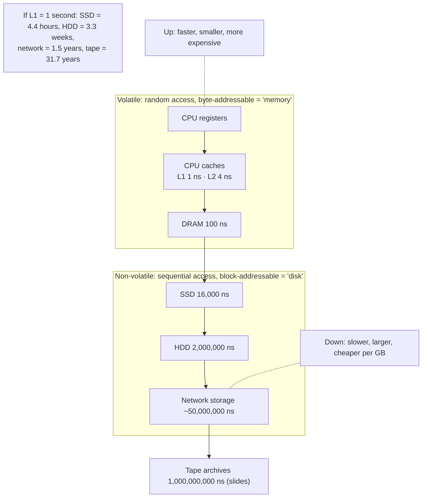

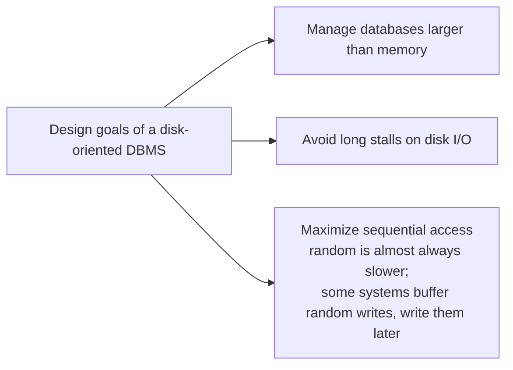

---

## 5. L03: files and pages

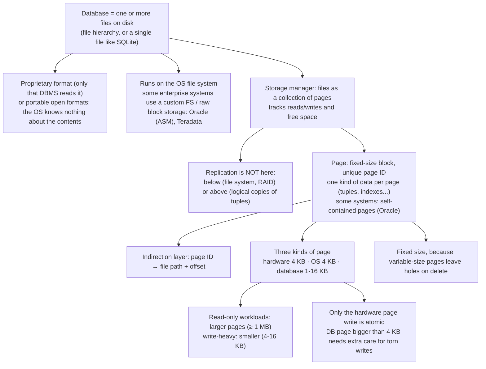

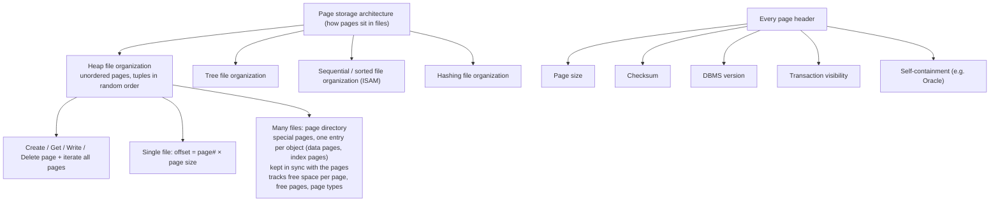

---

## 6. L03/L05: the three page layouts

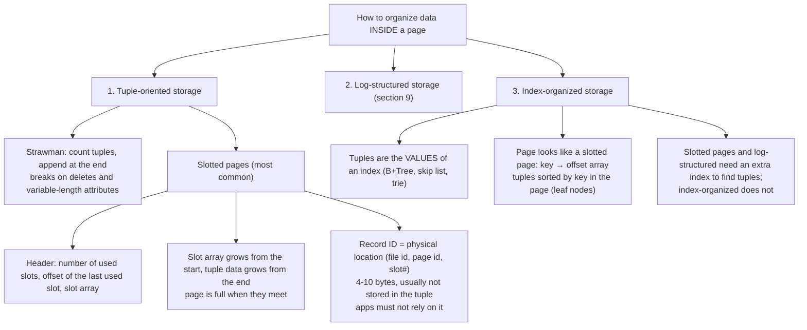

---

## 7. L03: tuple layout and data representation

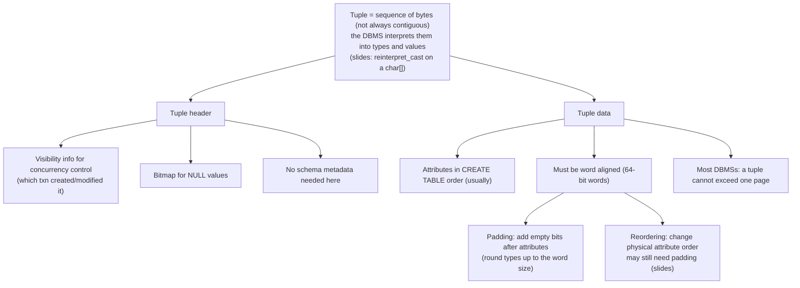

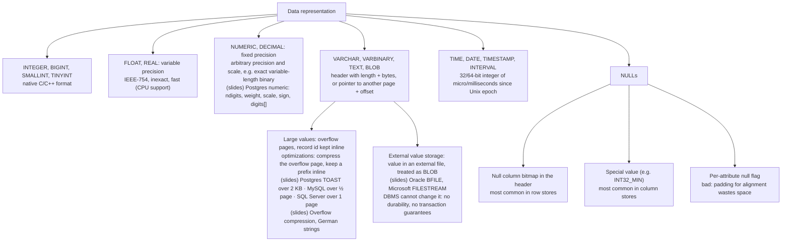

---

## 8. L05: tuple-oriented storage, step by step

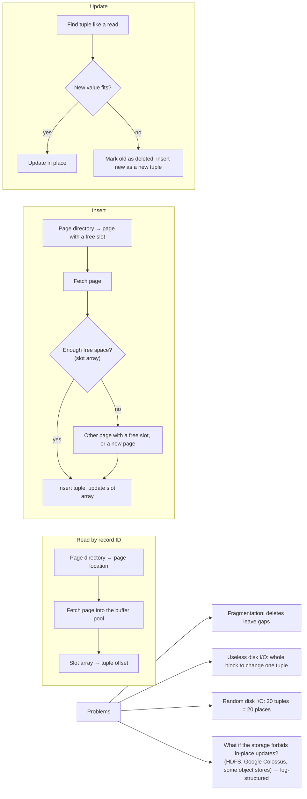

---

## 9. L05: log-structured storage

Based on log-structured file systems and LSM trees.

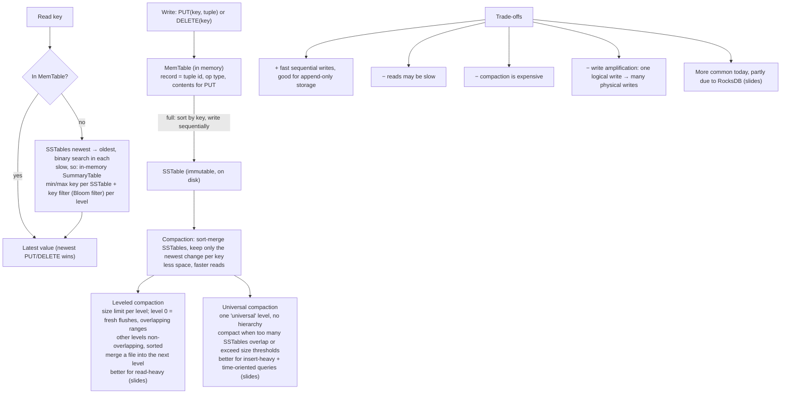

---

## 10. L06: workloads and storage models

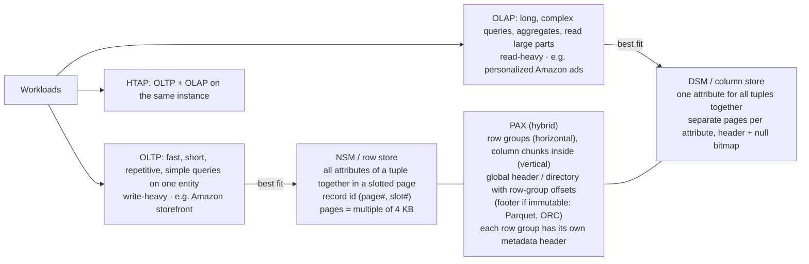

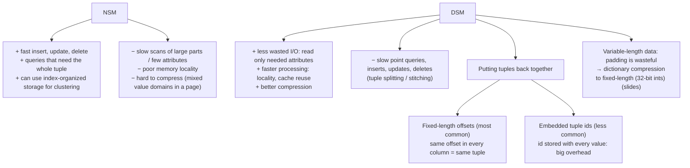

Mixing row and column storage (slides):

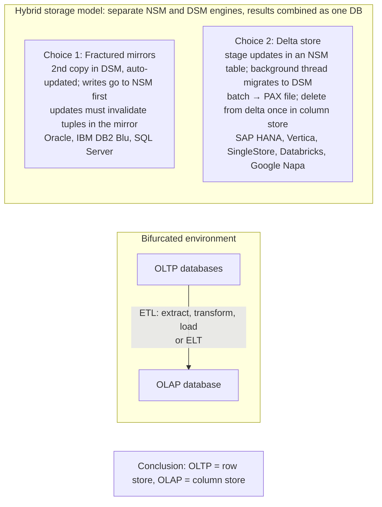

---

## 11. L06: compression

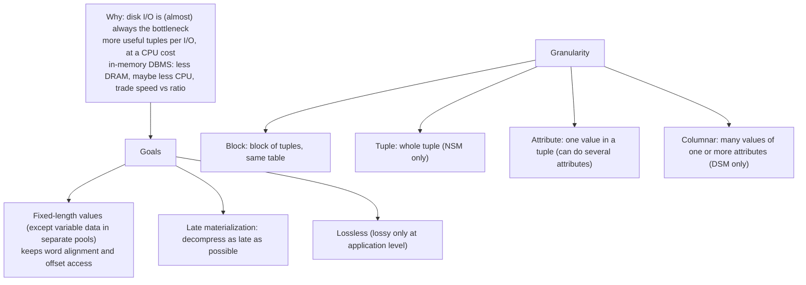

```mermaid
flowchart TB
    NAIVE["Naive compression: general-purpose algorithm<br/>Deflate, LZO, LZ4, Snappy, Oracle OZIP, Zstd, Lizard<br/>engineers pick faster over higher ratio"] --> N1["Compress pages, pad to a power of 2 KB, store in the buffer pool"]
    N1 --> N2["Must decompress before every read/update<br/>blind writes need no decompression"]
    N2 --> N3["Limits scope: cannot compress a whole table as one block<br/>→ MySQL splits the table into smaller chunks"]
    N3 --> N4["No semantics: does not know the data or the query → no late materialization"]
    N1 --> INNO["(slides) MySQL InnoDB: compressed pages of 1, 2, 4 or 8 KB + 'mod log'<br/>a read brings an uncompressed 16 KB copy into the buffer pool<br/>writes go to the mod log"]
```

```mermaid
flowchart TB
    COL["Columnar compression: read without fully decompressing"] --> RLE["Run-length encoding<br/>triplets: (value, start offset, run length)<br/>sort columns first to make longer runs"]
    COL --> BP["Bit packing<br/>values smaller than the declared size → fewer bits"]
    COL --> MOST["Patching / mostly encoding<br/>bit packing + marker for big values + lookup table"]
    COL --> BMP["Bitmap encoding<br/>one bitmap per distinct value, bit i = tuple i<br/>segmented into chunks<br/>only for LOW cardinality; Roaring Bitmaps for sparse"]
    COL --> DEL["Delta encoding<br/>store differences; base inline or in a lookup table<br/>+ RLE on deltas"]
    COL --> DICT["Dictionary compression (most common)<br/>frequent values → small codes + dictionary code ↔ value<br/>fast encode AND decode → no hash functions"]
    DICT --> OP["Order-preserving: codes sort like the values<br/>range queries + ops on codes"]
    OP --> OP1["LIKE 'And%' on the column: still scans the column"]
    OP --> OP2["SELECT DISTINCT ... LIKE 'And%': only the dictionary"]
    DICT --> BEST["(slides) Dictionary is probably the most useful: no pre-sorting needed<br/>schemes can be combined"]
```

---

## 12. L04: buffer pool

```mermaid
flowchart TB
    BPM["Buffer pool: in-memory cache of pages<br/>array of fixed-size FRAMES<br/>write-back cache (not write-through)"] --> PT["Page table (in memory only)<br/>page ID → frame"]
    PT --> DF["Dirty flag: page changed, write before eviction"]
    PT --> PIN["Pin / reference counter: threads using it<br/>pinned = cannot evict; full + all pinned = out-of-memory error<br/>pinning does not block other readers"]
    PT --> ACC["Access tracking info: who is accessing it"]
    BPM --> PD["Page directory (on disk, often cached)<br/>page ID → location in the database files<br/>changes must be recorded on disk for restart"]
    BPM --> POOLS["Other memory pools (may not be backed by disk)<br/>sorting + join buffers · query caches · dictionary caches<br/>maintenance buffers · log buffers"]
    CTRL["What the BPM optimizes"] --> SP["Spatial control: pages used together sit close on disk"]
    CTRL --> TP["Temporal control: when to read in / write out, fewer stalls"]
    LL["Locks vs latches"] --> LK["Lock: logical, protects DB contents (tuples, tables) between txns<br/>visible to users, must roll back"]
    LL --> LA["Latch: low-level, protects internal structures (hash table, memory)<br/>held for one operation, no rollback, mutex / condition variable"]
```

Fetch a page (from the definitions above):

```mermaid
flowchart TB
    REQ["Request page P"] --> HIT{"P in page table?"}
    HIT -->|yes| PINP["Pin P (count + 1), return frame pointer"]
    HIT -->|no| FREE{"Free frame?"}
    FREE -->|yes| LOAD["Read P from disk (page directory → file + offset) into the frame<br/>add P → frame to page table"]
    FREE -->|no| VIC{"Replacement policy finds an unpinned victim?"}
    VIC -->|no| OOM["Out-of-memory error"]
    VIC -->|yes| DIRTY{"Victim dirty?"}
    DIRTY -->|"no: fast path"| DROP["Just drop it"] --> LOAD
    DIRTY -->|"yes: slow path"| WB["Write victim to disk first"] --> LOAD
    LOAD --> PINP
```

---

## 13. L04: why not the OS (mmap)

```mermaid
flowchart TB
    MM["mmap: map the file into the address space<br/>OS moves pages; a page fault blocks the process"] --> P1["1. Transaction safety: OS can flush dirty pages at any time"]
    MM --> P2["2. I/O stalls: DBMS does not know what is in memory"]
    MM --> P3["3. Error handling: hard to validate pages, any access can SIGBUS"]
    MM --> P4["4. Performance: OS data-structure contention, TLB shootdowns"]
    MM --> FIX["Partial fixes: madvise (planned reads), mlock (no swap), msync (flush)<br/>just as hard as managing memory yourself"]
    BETTER["The DBMS does better itself"] --> B1["Flush dirty pages in the correct order"]
    BETTER --> B2["Specialized prefetching"]
    BETTER --> B3["Better replacement policies"]
    BETTER --> B4["Thread / process scheduling"]
    RULE["Never use mmap if you need to write. The OS is not your friend."]
```

---

## 14. L04: replacement policies

Goals: correctness, accuracy, speed, metadata overhead. A pinned page is never evicted.

```mermaid
flowchart TB
    POL["Replacement policies"] --> LRU["LRU (1965): timestamp of last access, evict oldest<br/>sorted queue helps, but overhead is large"]
    POL --> CLK["CLOCK (1969): LRU approximation, one reference bit per page<br/>(some use a counter above 1)"]
    POL --> LFU["LFU (1971): access count, evict lowest<br/>log complexity, ignores time, keeps stale popular pages"]
    POL --> LRUK["LRU-K (1993): last K access times → predict next access<br/>more storage; ghost cache of recently evicted pages"]
    POL --> MY["MySQL approximate LRU-K (LRU-2)<br/>one list, two entry points: young + old<br/>hit in old → head of young; new → head of old; evict tail of old"]
    POL --> ARC["ARC (2003, IBM Research)<br/>recency + frequency, adapts list sizes<br/>DB2, PostgreSQL (rewritten: patent), ZFS (slides)"]
    POL --> LOC["Localization: choose victims per query / txn"]
    POL --> HINT["Priority hints: txn tells the pool which pages matter"]
    PROB["Problems with LRU + CLOCK"] --> SF["Sequential flooding: a scan fills the pool, evicts useful pages<br/>for scans, the MOST recently used page is often the best victim"]
    PROB --> FQ["LRU ignores frequency"]
```

CLOCK eviction:

```mermaid
flowchart LR
    S["Eviction needed"] --> H["Look at page under the clock hand"]
    H --> R{"Reference bit = 1?"}
    R -->|yes| Z["Set bit to 0, move hand forward"] --> H
    R -->|no| E["Evict it, put new page here, move hand forward<br/>(hand position is remembered)"]
    A["Any access"] --> SET["Set the page's bit to 1"]
```

ARC lists and lookup protocol:

```mermaid
flowchart TB
    subgraph LISTS["ARC state"]
        T1["T1 recent list: accessed once recently"]
        T2["T2 frequent list: accessed at least twice"]
        B1["B1 ghost of T1: recently evicted from T1"]
        B2["B2 ghost of T2: recently evicted from T2"]
        PP["p: target size, favor recency (T1) vs frequency (T2)"]
    end
    L["Look up page X (a page is in only one list)"] --> Q1{"Where is X?"}
    Q1 -->|"T1 (hit)"| A1["Promote T1 → T2"]
    Q1 -->|"T2 (hit)"| A2["Stay in T2"]
    Q1 -->|"B1 (miss)"| A3["Increase p (favor recency), move X into T2"]
    Q1 -->|"B2 (miss)"| A4["Decrease p (favor frequency), move X into T2"]
    Q1 -->|"nowhere (miss)"| A5["If T1 + B1 full → evict from B1 or T1<br/>if T2 + B2 full → evict from B2 or T2<br/>insert X into T1"]
```

---

## 15. L04: dirty pages, I/O scheduling, OS cache, fsync

```mermaid
flowchart TB
    DP["Dirty pages"] --> FAST["Not dirty: drop (fast path)"]
    DP --> SLOW["Dirty: write back first (slow path)"]
    DP --> BG["Background writing: walk the page table, write dirty pages,<br/>then evict or just clear the dirty flag"]
    IOS["Disk I/O scheduling: OS/hardware reorder + batch but do not know priorities<br/>DBMS keeps its own queues; priority from:"] --> Q1["Sequential vs random I/O"]
    IOS --> Q2["Critical path vs background task"]
    IOS --> Q3["Table vs index vs log vs ephemeral data"]
    IOS --> Q4["Transaction information"]
    IOS --> Q5["User-based SLAs"]
    OSC["OS page cache (filesystem / buffer cache)"] --> DIO["Most DBMSs use direct I/O (O_DIRECT) to bypass it<br/>avoids redundant page copies, different eviction policies, loss of control"]
    OSC --> PG["PostgreSQL uses the OS page cache"]
    FSY["fsync problems"] --> F1["fsync fails (EIO) → Linux marks dirty pages clean"]
    F1 --> F2["Next fsync says success → DBMS wrongly thinks data is safe"]
```

---

## 16. L04/L05: buffer pool optimizations

```mermaid
flowchart TB
    OPT["Buffer pool optimizations"] --> MBP["Multiple buffer pools: per database, table, page type<br/>local policies, less latch contention, better locality"]
    MBP --> OID["Object ID: embed object id in record ids, map objects → pools<br/>finer control, storage overhead"]
    MBP --> HSH["Hashing: HASH(page id) % n picks the pool<br/>general, uniform"]
    OPT --> PRE["Pre-fetching from the query plan<br/>sequential scans: next pages · index scans: next LEAF pages (logical, not physical)<br/>(slides) some DBMSs prefetch to fill empty frames at start-up"]
    OPT --> SCAN["Scan sharing / synchronized scans<br/>2nd query attaches to the running cursor, remembers where it joined, finishes the rest<br/>not result caching · DB2, MSSQL, Teradata, Postgres; Oracle only identical queries<br/>continuous scan sharing: academic, wasteful"]
    OPT --> BYP["(slides) Buffer pool bypass: sequential scan does not store pages in the pool<br/>memory local to the query; also for temp data (sorting, joins)<br/>'light scans' in Informix"]
    WIN["DBMS beats the OS on: evictions, allocations, pre-fetching"]
```

---

## 17. L07: hash tables

```mermaid
flowchart TB
    DS["DBMS data structures"] --> D1["Internal metadata: page tables, page directories"]
    DS --> D2["Core data storage: the tuples"]
    DS --> D3["Temporary: built per query, e.g. hash table for a join"]
    DS --> D4["Table indexes: find tuples fast"]
    DD["Design decisions"] --> DD1["Data organization: layout and its effect on performance"]
    DD --> DD2["Concurrency: many threads, no conflicts, correct"]
    HT["Hash table: key → value, average O(1), worst O(n), storage O(n)<br/>no ordering, no sequential access"] --> HF["Hash function: big key space → small domain<br/>fast vs collision rate; deterministic<br/>NOT cryptographic (no SHA-2)"]
    HT --> HS["Hashing scheme: what to do on collisions<br/>bigger table vs extra work on collision"]
    HF --> HFL["(slides) CRC-64 1975 · MurmurHash 2008 · Google CityHash 2011 (short keys)<br/>Facebook XXHash 2012 ← state of the art (XXHash3) · Google FarmHash 2014 · RapidHash 2019"]
    HS --> STAT["Static: size fixed in advance<br/>full → rebuild bigger (usually 2×); use 2× slots vs expected elements"]
    HS --> DYN["Dynamic: grow / shrink on demand without a full rebuild"]
    STAT --> ASM["Assumptions that usually fail: known element count, unique keys, perfect hash"]
```

```mermaid
flowchart TB
    LP["Linear probe hashing: circular array of slots<br/>usually fastest; no pointers, cache friendly<br/>primary clustering at high load factor"] --> LPI["Insert: on collision scan next slots, wrap around"]
    LP --> LPL["Lookup: scan from the hashed slot until found,<br/>empty slot, or full loop → store key AND value in the slot"]
    LP --> LPD["Delete"]
    LPD --> TOMB["Tombstone (most common): lookups keep scanning, inserts can reuse it"]
    LPD --> SHIFT["Shift adjacent entries back (only ones that were shifted)<br/>rarely done: expensive"]
    LP --> KV["Key/value storage"]
    KV --> FIXKV["Fixed-length: inline in the hash table pages (+ optional stored hash)"]
    KV --> VARKV["Variable-length: data in a temp table; table stores hash → record id"]
    LP --> NU["Non-unique keys"]
    NU --> SLL["Separate linked list of values (may overflow pages)"]
    NU --> RED["Redundant keys: store the key many times (more common)"]
    LP --> LPO["Optimizations"]
    LPO --> O1["Specialized tables by key type/size (short strings inline, long → pointer/hash)"]
    LPO --> O2["Metadata in a separate array: empty/tombstone bitmap in page header"]
    LPO --> O3["Versions: bump table version to clear; slot version ≠ table version = empty"]
    LP --> ABSL["State of the art: Google absl::flat_hash_map"]
```

```mermaid
flowchart TB
    CK["Cuckoo hashing: several tables (or several hash functions into one table)<br/>same algorithm, different seeds"] --> CI{"Insert: a table has a free slot?"}
    CI -->|"yes (several: load factor or random)"| CPUT["Put it there"]
    CI -->|no| CEV["Pick a table (usually random), evict the old entry,<br/>rehash the old entry into another table"]
    CEV --> CYC{"Cycle?"}
    CYC -->|no| CPUT
    CYC -->|yes| CRB["Rebuild: new seeds (less common) or bigger tables (more common)"]
    CK --> CG["O(1) lookups and deletes, inserts can cost more<br/>(professor's note: hashing itself may not be O(1))"]
```

```mermaid
flowchart TB
    CH["Chained hashing (most common dynamic)<br/>linked list of buckets per slot; lookup = hash + scan the chain"] --> EX["Extendible hashing: split buckets instead of long chains<br/>many slots can point to one bucket; only the split bucket moves"]
    EX --> EXD["Global depth + local depth = number of most significant bits looked at"]
    EX --> EXS{"Bucket full → split. Local depth below global depth?"}
    EXS -->|yes| EXA["Add the new bucket to the existing slot array"]
    EXS -->|no| EXB["Double the slot array, global depth + 1"]
    LH["Linear hashing: split pointer = next bucket to split<br/>overflow criterion is up to the implementation"] --> LH1["ANY bucket overflows → split the bucket AT THE POINTER (even if it is another one)<br/>add a slot + new hash function (key % 2n), rehash that bucket"]
    LH1 --> LH2["Lookup: hash1 (key % n) points to a slot already passed by the pointer → use hash2"]
    LH2 --> LH3["Pointer reaches the last slot → drop hash1, pointer back to the start"]
    LH --> LH4["Shrink: highest bucket below the pointer empty → remove it, move pointer back"]
    LH --> LH5["Grows and shrinks incrementally: no full rebuild"]
    END["(slides) Hash tables are usually not what you want for a table index<br/>CREATE INDEX ... USING BTREE vs USING HASH"]
```

---

## 18. One-page recap

```mermaid
flowchart TB
    SQLR["SQL (declarative, bags) on the relational model"] --> EXEC["Planning + execution (later)"]
    EXEC --> AMR["Access methods: hash tables<br/>static: linear probe, cuckoo · dynamic: chained, extendible, linear"]
    AMR --> BPR["Buffer pool: frames, page table, pin, dirty<br/>LRU, CLOCK, LFU, LRU-K, MySQL LRU-2, ARC<br/>multiple pools, prefetch, scan sharing, bypass, O_DIRECT"]
    BPR --> STR["Storage: files → pages (heap + directory) → layout<br/>slotted · log-structured · index-organized<br/>tuple header + aligned data · NULL options · overflow / external"]
    STR --> MOD["Storage model: NSM · DSM · PAX · fractured mirrors · delta store"]
    MOD --> CMPR["Compression: naive (page) or columnar<br/>RLE, bit packing, mostly, bitmap, delta, dictionary"]
    CMPR --> DSK[("Disk: sequential beats random")]
```
